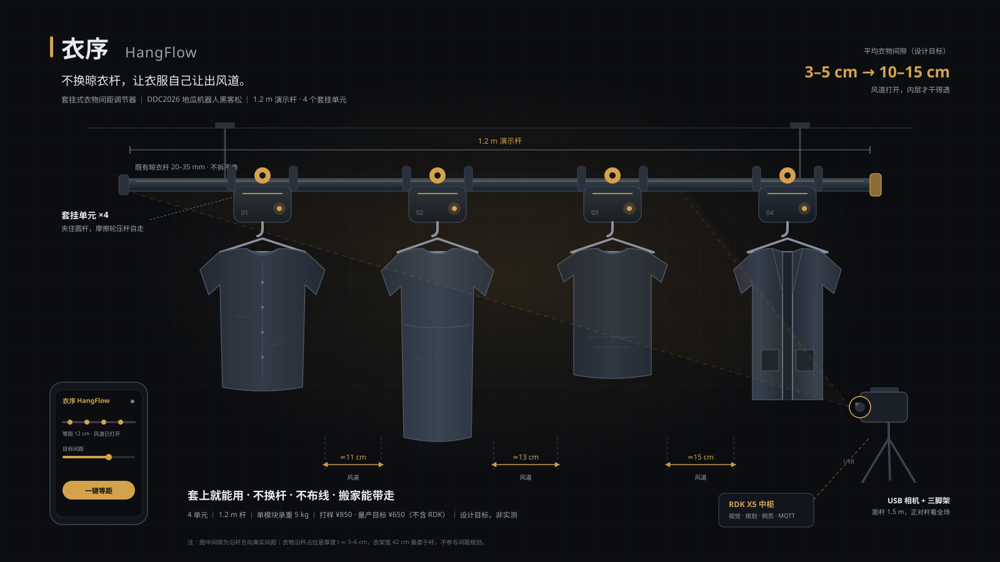

# 衣序 · HangFlow

> **不换晾衣杆，让衣服自己让出风道。**



一个**套挂式**的衣物间距调节器：几个巴掌大的模块夹在现有晾衣杆上，衣服挂在模块上，模块沿杆自己走；RDK 在下面用摄像头看全场、算间距、发指令；手机扫个码就能手动调，也能一键自动排开。

**参赛**：DDC2026 · 地瓜机器人黑客松（48H，2026.12.05—12.07，上海张江）
**仓库**：`theVivia/D-robotics-ClothesRodHelper`
**当前状态**：`方案 v1.0`（2026-11-23）—— 18 份文档 + 可跑原型（算法仿真 / 手机交互演示 / 参数化 CAD / 固件骨架 / 10 页路演 deck）；**实物未开造**，赛前 12 天计划见 [docs/10](docs/10-赛前12天准备计划.md)。

**先看这三个**：
1. 🎬 **路演 deck**：[deck/衣序-HangFlow-DDC2026.pdf](deck/衣序-HangFlow-DDC2026.pdf)（10 页，直接能讲）
2. 📱 **交互演示**：双击 [`app/index.html`](app/index.html)（离线可用，手机竖屏也行）
3. 📄 **一页纸方案**：[docs/00-执行摘要.md](docs/00-执行摘要.md)
4. 🖨️ **展台卡**：[deck/衣序-展台卡-A4.pdf](deck/衣序-展台卡-A4.pdf)（A4 打印，放在展台）
5. 📚 **完整方案书**：[deck/衣序-完整方案书.pdf](deck/衣序-完整方案书.pdf)（152 页，README + 全部文档合并，可打印/提交）

---

## 30 秒看懂

| | |
|---|---|
| **问题** | 梅雨季/回南天，衣服挤在杆上，中间没有风，外干内湿、返潮、发臭。想推开：够不着、推不齐、湿衣服重、杆还会歪。 |
| **方案** | 把"推衣服"这件事变成"模块自己走"：每个模块夹在杆上，靠摩擦轮沿杆移动，视觉告诉它该停在哪。 |
| **形态** | 不动杆、不装修、不换晾衣架。套上就能用，搬家能带走。 |
| **智能** | 手动档位 / 一键等距 / 按湿度分配间隙 / 一键收衣；卡住自停、低压报警、断电短时保持（机械自锁为 P1）。 |

一句话给评委：**我们不是造晾衣架，我们给已有晾衣杆装上"空间调度能力"。**

---

## 它是怎么工作的

```
                  ┌──────────── 手机网页（评委扫码即用）────────────┐
                  │  手动拖 / 一键等距 / 智能分配 / 收衣 / 急停      │
                  └───────────────────┬───────────────────────────┘
                                      │ HTTP + WebSocket（RDK 热点，局域网）
┌─────────────────────────────────────┴─────────────────────────────────────┐
│                        RDK X5 中枢（Ubuntu 22.04 + Python）                │
│   USB 相机 → 标定 + 视觉定位（衣架位姿/间距） → 间距规划器 → MQTT 指令      │
│   FastAPI 网页服务 · 日志与回放 · 异常监控                                  │
└─────────────────────────────────────┬─────────────────────────────────────┘
                                      │ Wi-Fi 2.4G（MQTT）
        ┌─────────────┬───────────────┼───────────────┬─────────────┐
        │  单元 #1    │   单元 #2     │   单元 #3     │  单元 #4    │
        │ ESP32-C3    │   ESP32-C3    │   ESP32-C3    │  ESP32-C3   │
        │ N20+AS5600  │   N20+AS5600  │   N20+AS5600  │  N20+AS5600 │
        │ 摩擦轮自走  │   摩擦轮自走  │   摩擦轮自走  │  摩擦轮自走 │
        │ 18650       │   18650       │   18650       │  18650      │
        └─────────────┴───────────────┴───────────────┴─────────────┘
                    ▲ 夹在 20–35mm 圆杆上，衣服挂在单元侧钩上
```

- **套挂单元（ClipUnit）**：C 形夹爪夹住圆杆；顶部硅胶摩擦轮压着杆走；两个惰轮防翻转；侧面挂衣钩承受衣服重量；ESP32-C3 做闭环，18650 供电，不用布线。
- **中枢（Hub）**：RDK X5 一颗板全包——相机接入、视觉定位、规划、网页服务、MQTT broker。
- **闭环**：编码器给里程，视觉给绝对位置校准，两者互补；卡住时电流突增 + 视觉不动 → 立刻停。

---

## 为什么是 RDK

1. **一颗板全包**：X5 的 8 核 A55 跑标定/规划/网页，10 TOPS BPU 留给视觉模型；4 路 USB3 + 2 路 MIPI CSI + 40PIN，相机、传感器、下位机都能直连。
2. **能升级**：今天用 ArUco 做定位，明天换 BPU 上的分割模型做"衣物识别 + 湿度估计"，硬件不用换。
3. **能外延**：RDK 同时是家庭里其他设备的中枢，产品故事从"晾衣杆"延伸到"阳台空间管理"。
4. **现场管够**：赛事现场发放 RDK X5 / S100 / S600、奥比中光深度相机、飞特舵机、3D 打印与 PCB 打样，48 小时能真的做出东西。

---

## 关键指标（设计目标，非实测）

| 指标 | 目标 | 说明 |
|---|---|---|
| 单元数量 | **2—8 个**（现场 4 个） | 按杆长和需求增删；每个单元独立地址 01—08 |
| 适配杆长 | **0.8—2.4 m**（端部各留 50mm） | 伸缩杆/顶天立地杆/两端墙都支持；>1.8m 建议加中间吊撑 |
| 杆中心到墙 | ≥120 mm（建议 150） | 低于 80mm 时衣摆可能蹭墙，界面会提示 |
| 单模块承重 | 5 kg | 湿羽绒服约 2–3kg，留 2× 余量 |
| 移动速度 | 4–6 cm/s | 20cm 约 4–5 秒，安静 |
| 定位精度 | ±5 mm（AS5600 + 视觉校正后 ±3 mm） | 间隙误差 <1cm 即可感知 |
| 最小安全间隙 | 3 cm | 视觉/ToF 双重防撞 |
| 续航 | 在线待机约 2 天 / 纯动作 ≥3000 次 | 18650 2000mAh，设计值；演示需备电池 |
| 整机成本 | 打样 ≈¥850（不含 RDK）/ ≈¥1,400（含 RDK）；量产目标 ≈¥650 | 4 单元 + 相机 + 演示架；BOM 见 docs/09 |
| 调整耗时 | 4 件衣服 ≤ 45 s（典型 30 s） | 串行让位，速度刻意压慢 |

---

## 仓库导航

| 想看什么 | 去哪里 |
|---|---|
| **一页纸方案** | [docs/00-执行摘要.md](docs/00-执行摘要.md) |
| 这个比赛怎么打 | [docs/01-赛题解读与参赛策略.md](docs/01-赛题解读与参赛策略.md) |
| 产品定义/用户/竞品 | [docs/02-产品定义与用户研究.md](docs/02-产品定义与用户研究.md) |
| 系统怎么搭 | [docs/03-系统总体方案.md](docs/03-系统总体方案.md) |
| 机械结构 | [docs/04-机械结构设计.md](docs/04-机械结构设计.md) · [hardware/cad](hardware/cad) |
| 电控与接线 | [docs/05-硬件与电控设计.md](docs/05-硬件与电控设计.md) · [hardware/wiring](hardware/wiring) |
| 视觉与算法 | [docs/06-视觉与算法.md](docs/06-视觉与算法.md) · [sim](sim) |
| 软件架构/协议 | [docs/07-软件架构与通信协议.md](docs/07-软件架构与通信协议.md) |
| 交互与 App | [docs/08-交互与App设计.md](docs/08-交互与App设计.md) · [app](app) |
| **安装场景 / 两端墙 / 伸缩杆 / 增删单元** | [docs/18-安装场景与墙体适配.md](docs/18-安装场景与墙体适配.md) |
| 成本 | [docs/09-BOM与成本.md](docs/09-BOM与成本.md) |
| 赛前 12 天怎么准备 | [docs/10-赛前12天准备计划.md](docs/10-赛前12天准备计划.md) |
| 现场 48 小时怎么打 | [docs/11-现场48小时执行计划.md](docs/11-现场48小时执行计划.md) |
| 演示与答辩 | [docs/12-演示脚本与答辩.md](docs/12-演示脚本与答辩.md) |
| 会怎么翻车 | [docs/13-风险与PlanB.md](docs/13-风险与PlanB.md) |
| 怎么验收 | [docs/14-测试与验收.md](docs/14-测试与验收.md) |
| 怎么变成生意 | [docs/15-产品化与商业化.md](docs/15-产品化与商业化.md) |
| AI 怎么用的（赛中必交） | [docs/16-AI辅助开发与过程证据.md](docs/16-AI辅助开发与过程证据.md) |
| **RDK 平台与开发环境** | [docs/17-RDK平台与开发环境.md](docs/17-RDK平台与开发环境.md) |
| 路演 PPT（10 页 / PDF） | [deck/](deck) · [衣序-HangFlow-DDC2026.pdf](deck/衣序-HangFlow-DDC2026.pdf) |
| 完整方案书（152 页 PDF） | [deck/衣序-完整方案书.pdf](deck/衣序-完整方案书.pdf) · 源文件 [deck/book.html](deck/book.html) |
| 展台卡（A4） | [deck/衣序-展台卡-A4.pdf](deck/衣序-展台卡-A4.pdf) |
| 固件（ESP32-C3） | [firmware/esp32-module](firmware/esp32-module) |
| 中枢软件 / 无硬件 mock | [software/hub](software/hub) |
| 图片与图表 | [assets/diagrams](assets/diagrams) · [docs/figures](docs/figures) |

---

## 快速体验（不用硬件）

1. **看交互**：双击打开 [`app/index.html`](app/index.html)（单文件，离线可用）。拖模块、改杆长（0.8—2.4m）、增删单元（2—8）、点"一键等距"、调湿度，看它怎么排。真实 390×844 手机视口验证截图在 [`app/.verify/`](app/.verify)。
2. **跑算法**：`python sim/run_all.py`（12 秒），生成 7 张 300dpi 图 + `docs/_data/algorithm-results.md`。
3. **跑中枢 mock**：`python -m software.hub.mock_demo`（4 个虚拟单元，串行下发、到位校验、写 JSONL 日志）。
4. **验视觉链路**：`python sim/vision_demo.py`（合成图 ArUco 检测 6/6，输出误差图）。
5. **看路演**：打开 [deck/衣序-HangFlow-DDC2026.pdf](deck/衣序-HangFlow-DDC2026.pdf)，或双击 `deck/index.html` 用方向键放映。
6. **读方案**：从 [docs/00-执行摘要.md](docs/00-执行摘要.md) 开始，10 分钟看完；要细节再按目录跳。

> 需要 Python 3.11 + numpy/scipy/matplotlib；无第三方硬件依赖。

---

## 已经跑通 / 已生成的东西（2026-11-23）

| 项 | 验证方式 | 结果 |
|---|---|---|
| 间距规划 + 重排 + 控制 + 视觉误差仿真 | `python sim/run_all.py` | 17/17 单测通过，7 张图，12 秒 |
| 中枢 mock 端到端（4 虚拟单元） | `python -m software.hub.mock_demo` | PASS，串行 36.2s（≤45s），净空 98.9—103mm；`--rod/--n` 可改（6 单元/2m 为 72s） |
| 视觉链路合成验证 | `python sim/vision_demo.py` | 6/6 标记检出，系统偏移 0.82mm |
| 手机/桌面交互页 | Edge headless 截图 + DevTools 390×844 | 无 console 报错，390 视口零越界；杆长/单元数/杆离墙可调，两端墙与端部余量已画，拥挤/离墙告警分开 |
| 路演 deck | 逐页截图检查 + PDF 导出 | 10 页，16:9 |
| A4 展台卡 | Edge 打印导出 | 1 页 A4 |
| CI（GitHub Actions） | `.github/workflows/ci.yml` | push 时跑单测/仿真/mock/链接检查 |
| 机械 CAD | OpenSCAD 参数模型（未渲染） | `hardware/cad/clip_unit.scad`，5 条 assert |
| 固件 | 骨架（未上真机） | 引脚/协议/安全判据与 docs/05 对齐 |

> 未验证的：所有实物性能（打滑、承重、续航、温升）、相机标定实测、Wi-Fi 现场干扰。这些是赛前 12 天的任务，不是"已完成"。

---

## 赛程

```
11.23 今天 ──► 11.30 参赛确认截止 ──► 12.04 装箱 ──► 12.05 13:00 开赛
   │               │                                    │
   └ 方案定稿       └ 采购到货 + 打样完成                 └ 48H 现场：集成 → 调试 → 提交
                                                            12.07 12:00 提交 / 14:00 评审 / 18:30 路演
```

赛前 12 天的逐日任务见 [docs/10](docs/10-赛前12天准备计划.md)；现场逐小时任务见 [docs/11](docs/11-现场48小时执行计划.md)。

---

## 团队与分工（预设 4 人，可压缩）

| 角色 | 负责 | 现场关键产出 |
|---|---|---|
| 队长 / 系统 & 视觉 | 架构、视觉标定、规划器、网页 | 端到端链路跑通、演示控场 |
| 机械 | 夹爪/摩擦轮/外壳、3D 打印、装配 | 4 个单元能夹稳、能走直 |
| 电控 | 主控、驱动、电源、接线、固件 | 单元上线、急停可靠 |
| 交互 / 产品 | 网页 UI、演示脚本、答辩材料、过程记录 | 评委看到的东西好看、听得懂 |

> 只有 1–2 人时，按 [docs/13](docs/13-风险与PlanB.md) 的"瘦身版"砍到 2 个单元 + 单向等距。

---

## 诚实声明

- 本仓库当前是**方案与预研**，不是完成品；所有性能数字均为设计目标或估算，实测数据会在赛前准备与现场调试后替换。
- RDK X5 规格引用官方/代理页面（40PIN 保守按 3.3V 800mA / 5V 500mA 设计；板卡供电 5V/5A），现场以实际板卡为准。
- RDK 的系统、40PIN、相机、BPU 与现场流程整理在 [docs/17](docs/17-RDK平台与开发环境.md)，含官方来源链接。
- 项目归属：仓库所有者 theVivia；AI 辅助开发过程按要求留痕，见 [docs/16](docs/16-AI辅助开发与过程证据.md)。


