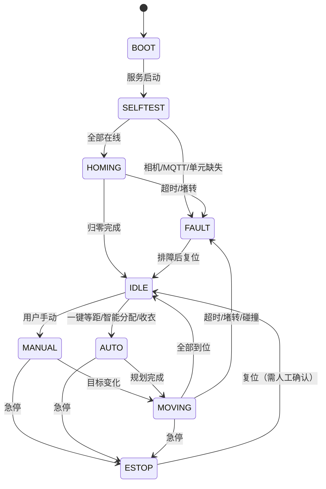

# 系统总体方案

> **这份文档回答：整个系统由哪些部分组成、怎么连起来、数据怎么流、坏了怎么办。**
> 读完这一篇，应该能在白板上把系统画出来。

---

## 1. 设计目标与约束

| 目标 | 约束 |
|---|---|
| 4 个单元在 1.2m 杆上协同 | 支持 2—8 单元、0.8—2.4m 杆（现场 4 单元/1.2m）；48 小时内可装配、可调试 |
| 手动 + 自动两种控制 | 现场 Wi-Fi 环境不可控（几十个队伍同频） |
| 定位误差 ≤10mm（看得见的间距差异） | 只能用便宜电机（N20 级）与 3D 打印 |
| 断网/断电/卡住都不能伤人 | 评委与观众会靠近演示台 |
| 所有代码现场可改 | 队友水平不一，架构必须"一个人也能看懂" |

---

## 2. 分层架构

```
┌──────────────────────────────────────────────────────────────────────┐
│ L4 交互层   手机网页（评委扫码） · 模块按键/LED · 语音(P2)              │
├──────────────────────────────────────────────────────────────────────┤
│ L3 智能层   RDK X5：视觉定位 → 间距规划 → 任务调度 → 异常监控           │
│             FastAPI + WebSocket · MQTT Broker · 日志/回放              │
├──────────────────────────────────────────────────────────────────────┤
│ L2 通信层   Wi-Fi 2.4G · MQTT（QoS1）· JSON 协议 · 心跳/重连            │
├──────────────────────────────────────────────────────────────────────┤
│ L1 执行层   ESP32-C3 ×4：速度/位置闭环 · 编码器 · ToF · 电流保护        │
├──────────────────────────────────────────────────────────────────────┤
│ L0 物理层   套挂单元 ×4 · 1.2m 演示杆 · 相机 · 左端归零挡块             │
└──────────────────────────────────────────────────────────────────────┘
```

### 为什么是"中枢 + 分布式单元"，不是"一根导轨 + 一个电机"

| 方案 | 优点 | 缺点 | 结论 |
|---|---|---|---|
| 单电机 + 同步带 + 导轨 | 便宜、同步性好 | 要定制杆/导轨，违背"零改造"；间距被机械固定 | ✗ |
| 单电机 + 丝杠 + 离合 | 结构紧凑 | 离合复杂、行程短、成本高 | ✗ |
| **每单元自带电机自走** | **零改造、可扩展、单点故障不影响全局** | 需要电池、需要通信、会打滑 | **✓ 采用** |
| 集中式线缆供电 | 不用充电 | 线随模块动，易缠绕；杆上走线难看 | ✗（P2 可选滑触线） |

---

## 3. 硬件与网络拓扑

```
                    ┌─────────────── 手机 / 平板 ───────────────┐
                    │ 浏览器（无需装 App）                       │
                    └───────────────┬───────────────────────────┘
                                    │ Wi-Fi 2.4G（RDK 热点）
┌───────────────────────────────────┴───────────────────────────────────┐
│ RDK X5（5V/5A Type-C，65W PD 充电宝）                                  │
│  ├─ USB 相机（720p/30fps，三脚架，距杆 1.5m，正对杆）                  │
│  ├─ mosquitto（MQTT broker，1883）                                     │
│  ├─ FastAPI（8000，网页 + REST + WS）                                  │
│  └─ systemd: hangflow.target（相机/视觉/规划/桥接/网页 5 个服务）      │
└───────────────────────────────────┬───────────────────────────────────┘
                                    │ Wi-Fi（MQTT over TCP）
      ┌──────────────┬──────────────┼──────────────┬──────────────┐
      │  unit-01     │  unit-02     │  unit-03     │  unit-04     │
      │  ESP32-C3    │  ESP32-C3    │  ESP32-C3    │  ESP32-C3    │
      │  18650×1     │  18650×1     │  18650×1     │  18650×1     │
      └──────────────┴──────────────┴──────────────┴──────────────┘
                                    │
                          ┌─────────┴─────────┐
                          │ 演示杆 1.2m + 左端 │
                          │ 归零挡块 + 右端挡块│
                          └───────────────────┘
```

**网络细节**

- RDK 开热点：SSID `HangFlow-XX`，WPA2，2.4G，固定信道（现场先用 `iw dev wlan0 scan` 选最空的道，建议 1/6/11 里挑）。
- 单元预配 Wi-Fi 凭据（`WiFi.begin` + NVS 存储）；现场改网用手机热点兜底（SSID/密码写在便签上）。
- MQTT：RDK 本地 broker，不做公网；QoS1 + retain 保留最后状态。
- IP：RDK 热点 DHCP 固定租约（`dnsmasq` 配置），单元 IP 写死映射，避免重连后找不到。

---

## 4. 运行时架构（RDK 侧 5 个进程）

| 进程 | 语言 | 职责 | 输入 | 输出 |
|---|---|---|---|---|
| `cam_node` | Python | 取流、畸变校正、掉帧检测 | USB 相机 | 帧（共享内存/ZeroMQ） |
| `vision_node` | Python + OpenCV | ArUco 检测、PnP、杆坐标映射、间距计算 | 帧 | `vision` 话题：每个单元 x 坐标 + 置信度 |
| `planner_node` | Python | 模式状态机、间距规划、目标下发 | 视觉 + 用户指令 + 单元状态 | `cmd` 话题 |
| `bridge_node` | Python | MQTT ↔ 内部总线；心跳、重连、指令去重 | 内部消息 | MQTT |
| `web_server` | FastAPI | 网页、REST、WebSocket 推送、日志 | HTTP/WS | HTML/JSON |

> **为什么不用 ROS2 全栈？** 48 小时内，ROS2 的 DDS 发现、QoS、跨机配置是纯风险；我们用"ROS2 风格的话题命名 + 纯 Python 消息总线"，一个人能看懂、改得动。产品化时再把接口封装成 ROS2 节点（见 ADR-7）。

**内部总线**：`queue.Queue` + 线程（够用）；跨进程用 `multiprocessing.Queue` 或直接 5 个线程同进程（推荐后者，减少故障面）。最终实现：**单进程多线程**，`apps/hub/main.py` 启动所有线程；每个线程一个 `while not stop`。简单、可控、好调试。

---

## 5. 数据流与延迟预算

```
相机 30fps ──33ms──► 视觉检测(ArUco+PnP) ──15ms──► 规划(微秒级) ──5ms──► MQTT ──20ms──► ESP32 接收
                                                                              │
   手机按钮 ──HTTP──► web_server ──► planner ──同上──► 单元动作 ──► 状态 10Hz ──► 网页 5Hz
```

| 环节 | 预算 | 说明 |
|---|---|---|
| 相机采集 | 33 ms | 30fps |
| ArUco 检测 + PnP | 15—25 ms | 720p，4 个标记，A55 单核 |
| 规划 | <2 ms | 闭式解，N≤8 |
| MQTT 传输 | 10—30 ms | 局域网，QoS1 |
| 固件响应 | 20 ms | 控制周期 50Hz |
| **端到端（按钮→开始动）** | **<150 ms** | 体感"立即" |
| 视觉校正周期 | 200—500 ms | 外环，死区 3mm |

**带宽**：4 单元 × 10Hz × 约 250B = 10KB/s，忽略不计。视频只在网页预览时按需推（MJPEG，2Mbps）。

---

## 6. 坐标系与标定

### 6.1 坐标定义

- **杆坐标 x**：沿杆，左端挡块 = 0，向右为正，单位 mm，范围 `[0, L]`；可用段为 `[m, L−m]`（端部余量 `m` 默认 50mm，可按墙支架厚度调）。
- **两端有墙**时 `L` = 两墙净距，单元不越过挡块；收衣方向可选（见 [docs/18](18-安装场景与墙体适配.md)）。
- **相机坐标**：OpenCV 相机系（右 x、下 y、前 z）。
- **标定参照**：杆两端各贴一个固定 ArUco（ID 100/101，边长 30mm），已知间距 L；由此解出"杆轴在相机系中的直线方程 + 尺度"。
- **单元标记**：每个单元顶部贴 ArUco（ID 1—4，边长 30mm），PnP 得到位姿，取标记中心投影到杆轴 → x。

### 6.2 标定流程（现场 2 分钟）

1. 把标定板（两端标记 + 卷尺刻度）放到杆上，确认两端标记中心距 = L；
2. 相机固定（三脚架），`python tools/calibrate.py --intrinsics`（赛前用棋盘格标好内参，存 JSON）；
3. 采集 30 帧，求杆轴与尺度，写入 `calib.json`；
4. 用卷尺抽检 3 个位置，误差 >3mm 则重新采。

> 内参赛前标定（棋盘格 9×6，1.5m 距离 20 张），现场只做外参/尺度。这样 48h 内少一个坑。

### 6.3 视觉失败的降级

| 情况 | 降级策略 |
|---|---|
| 标记被衣服挡住 | 用编码器里程 + 上一次视觉位置推算；提示"视觉遮挡" |
| 光照太暗/过曝 | 提高曝光/开补光；掉到纯编码器模式 |
| 相机离线 | 全系统进入"里程计模式"，精度降到 ±15mm，仍可演示 |
| 标记识别错 ID | 连续 3 帧一致才采信；跳变 >50mm 视为异常丢弃 |

---

## 7. 状态机

### 7.1 系统态（中枢）



### 7.2 单元态（固件）

`BOOT → WIFI → MQTT → IDLE → MOVING → (HOLDING) → IDLE`；异常进 `ESTOP/FAULT`，本地按键可复位。

---

## 8. 关键时序：一次"一键等距"

```
用户点按钮
  │
  ├─ web_server 收到 POST /api/mode {mode:"equalize", gap:100}
  ├─ planner 读取当前视觉位置（4 个 x）+ 衣物厚度 t_i（UI 输入或默认 40mm）
  ├─ planner 计算目标位置（闭式解，见 docs/06）
  ├─ planner 计算目标位置（闭式解，见 docs/06；P0/P1 不换序）
  ├─ planner 逐条下发 MQTT: flow/unit-0i/cmd {"seq":12,"target_mm":420,"speed":45}
  ├─ ESP32 收到 → 校验 seq → 闭环移动到目标 → 到达后发布 state
  ├─ vision 每 300ms 校正：|x_visual - x_target| > 3mm → 下发修正
  ├─ 全部到位 → planner 发 "done" → web 弹"已排开"
  └─ 全过程日志写入 logs/run-*.jsonl（可回放）
```

**并发约束**：多个单元同时移动会互相干扰（ToF 防撞），所以 planner 按"从左到右、依次让位"串行下发；单次最长移动约 50cm（11s @4.5cm/s），4 个串行合计 30—45s。速度故意压慢：现场看是"稳"，不是"慢"，且打滑与噪音都更低。

---

## 9. 安全设计（五层）

| 层 | 措施 | 触发 | 动作 |
|---|---|---|---|
| L1 硬件 | 电源开关、保险丝 | 人为 | 全断电 |
| L2 固件 | 堵转判据：PWM 给定 + AS5600 角度 300ms 内不变（DRV8833 模块无采样电阻，无硬件限流） | 堵转、夹手 | 立即停 + 回退 10mm + 红灯 |
| L3 固件 | ToF 邻距 <60mm | 即将碰撞 | 停 + 回退 20mm |
| L4 固件 | 心跳丢失 500ms | Wi-Fi 断 | 原地停 + 蜂鸣 |
| L5 中枢 | 视觉最小间隙 <30mm / 超时 10s | 规划错误/卡死 | 全局停 + UI 报警 |
| L6 交互 | 网页红色急停 + 模块按键 | 人为 | 全部 stop，需人工复位 |

**失效安全原则**：任何一层挂了，默认动作是"停"，不是"继续"。断电时电机 H 桥短路刹车 + 高减速比静摩擦，可短时保持（实测滑移距离）；**长期承重不掉需要 P1 的机械锁**，这版不承诺。

---

## 10. 技术选型决策记录（ADR）

| # | 决策 | 选择 | 备选 | 理由 |
|---|---|---|---|---|
| ADR-1 | 中枢平台 | RDK X5 4GB | X3 / S100 / 树莓派 | 10TOPS + 4×USB3 + 双 CSI；现场发放；资料最全 |
| ADR-2 | 单元主控 | ESP32-C3 | ESP32-S3 / STM32+Wi-Fi | 便宜、Wi-Fi 内置、Arduino/IDF 都行、功耗低 |
| ADR-3 | 单元通信 | Wi-Fi + MQTT | ESP-NOW / BLE / RS485 | 免布线；MQTT 易调试（`mosquitto_sub` 就能看） |
| ADR-4 | 定位 | 编码器 + 视觉 ArUco | 纯视觉 / 纯编码器 / UWB | 单源都有缺陷；双源互补，成本几乎为零 |
| ADR-5 | 驱动 | N20 6V 直驱 Ø28 轮 + 编码器闭环保持 | 步进 / 舵机 / 自锁蜗轮 | 便宜、扭矩够、静音；自锁蜗轮会牺牲速度，列为 P1 |
| ADR-6 | 供电 | 每单元 18650 | 滑触线 / 集中电源 | 免布线、可换电池、现场最稳 |
| ADR-7 | 中枢软件 | 单进程多线程 Python | ROS2 全栈 | 48h 降低故障面；话题命名保留 ROS2 风格，便于迁移 |
| ADR-8 | 交互 | 手机网页 | 原生 App / 小程序 | 扫码即用、无需审核、跨平台、现场改 UI 快 |
| ADR-9 | 视觉模型 | P0 不用神经网络 | YOLO/分割 | 衣物数据没有，48h 训不出来；ArUco 是"确定性"方案；P2 再上 BPU |

> ADR-9 很重要：**不要为了"AI 感"硬上模型**。评委问"为什么不用 YOLO"，答案是"48 小时内没有可靠的衣物数据集，用标记做绝对定位是工程上正确的选择；BPU 留给下一版做材质/湿度识别"。

---

## 11. RDK 能力映射（回答"为什么非它不可"）

| RDK 能力 | 本项目用法 | 如果换树莓派/PC |
|---|---|---|
| 8×A55 CPU | 相机、ArUco、规划、Web、MQTT 全跑 | 也能跑，但多路相机/BPU 没有 |
| 10 TOPS BPU | P1/P2：衣物检测、湿度/材质分类 | 需要外接加速棒 |
| 4×USB3 | 相机 + 深度相机 + 调试 | 通常够，但带宽/供电紧张 |
| 2×MIPI CSI | 双目/第二视角（P2） | 需转接 |
| 40PIN（3.3V 逻辑；保守 3.3V 800mA / 5V 500mA） | 状态灯、按键、传感器扩展 | 需电平转换 |
| Wi-Fi 6 + 蓝牙 5.4 | 热点 + 单元连接 | 需外接 |
| CAN FD | 未来接升降晾衣架/机械臂 | 需扩展板 |
| 5V/5A 供电 | 带 4 单元 + 相机 + 屏幕 | 供电方案更麻烦 |

> 答辩话术：**"我们不是在树莓派上跑个脚本，我们是在为'家庭空间机器人'选一个能长期演进的大脑。"**

---

## 12. 现场部署（一键启动）

```bash
# RDK 上（赛前做好，现场只跑这一条）
cd ~/hangflow && ./scripts/start_all.sh
# 等价于：
#   sudo nmcli dev wifi hotspot ifname wlan0 ssid HangFlow-01 password hangflow2026
#   systemctl start hangflow.target   # cam/vision/planner/bridge/web
#   mosquitto_sub -t 'flow/#' -v     # 调试窗口
```

- 开机自启（systemd）→ 断电重启后 40 秒内恢复。
- 网页地址 `http://192.168.4.1:8000`（热点网关），二维码贴在展台。
- 日志目录 `~/hangflow/logs/`，每 10 分钟滚动；现场演示后导出 `run-*.jsonl` 作为"开发过程"证据。

---

## 13. 扩展性（产品化方向）

1. **多杆**：中枢支持多根杆的坐标系（每根杆一组标定），一个 RDK 带 2—3 根杆。
2. **多户/云**：MQTT bridge 到云，做远程状态与 OTA；隐私上只传状态不传视频。
3. **接升降晾衣架**：CAN FD 或 485 控制升降电机，做"升降 + 间距"一体。
4. **接机械臂**：RDK 上跑抓取，做"自动挂衣"的上层。
5. **数据价值**：不同材质/湿度下的最佳间距 → 形成"晾晒参数库"，越用越准。

---

## 14. 功能裁剪与依赖

```
P0（必须）：单元移动 + 一键等距 + 收衣 + 网页控制 + 急停 + 视觉读数
  依赖：机械装配 ✓ / 固件闭环 ✓ / MQTT ✓ / 网页 ✓ / ArUco ✓
P1（争取）：智能分配 + 视觉闭环校正 + 低电/离线提示
  依赖：P0 全部 + 视觉精度 + 规划器
P2（锦上添花）：BPU 衣物检测 + 语音 + 多杆
  依赖：P1 + 数据集/模型
```

**裁剪原则**：P0 任一环节没通，立即停 P1；P1 没通，答辩只讲"已实现 + 路线图"，不吹。

---

## 15. 已知技术债（诚实清单）

| 债 | 影响 | 何时还 |
|---|---|---|
| 摩擦轮打滑未实测 | 里程误差可能 >5% | 赛前打样实测，视觉校正兜底 |
| Wi-Fi 现场干扰未知 | 掉线/延迟 | 带备用手机热点 + ESP-NOW 方案 B |
| 相机内参用通用值 | 定位误差偏大 | 赛前用棋盘格标定 |
| 电池续航未实测 | 演示中途没电 | 带 8 节备用 18650 + 充电器 |
| 3D 打印件强度未验证 | 断裂 | 加厚关键受力处，带备用件 |
| 无正式用户测试 | 需求判断偏差 | 赛前 5 个访谈（[docs/02](02-产品定义与用户研究.md)） |
