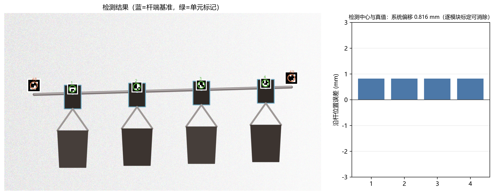

# 视觉与算法

> ⚠️ **v1 文档（衣架挂在自走模块上）已于 2026-11-23 废弃；现行 v2 见 [docs/v2/README.md](v2/README.md)（[总览](v2/00-总览与架构.md)）。**

> **这份文档回答：摄像头怎么知道每件衣服在哪、间距怎么算、多个模块怎么不打架、误差多大。**
> 对应代码：`sim/spacing_planner.py`（可跑的规划器）、`software/hub/vision/`（视觉）、`docs/_data/algorithm-results.md`（仿真数字）。

---

## 1. 问题拆解

要让 4 个模块自己排开，需要回答四个问题：

| # | 问题 | 解法 | 难度 |
|---|---|---|---|
| Q1 | 每个模块现在在哪？ | 相机看 ArUco + PnP → 杆坐标 x | 中 |
| Q2 | 每件衣服多厚、多湿？ | 用户选 + 默认值；P2 深度/视觉估计 | 低（P0）/ 高（P2） |
| Q3 | 目标位置应该在哪？ | 加权间隙分配（闭式解） | 低 |
| Q4 | 顺序不对怎么办？ | P0/P1 不换序，只分配间隙；P2 抬升越障 | 中 |
| Q5 | 走的过程中怎么不撞？ | ToF 邻距 + 视觉最小间隙 + 串行执行 | 低 |

---

## 2. 视觉定位

### 2.1 为什么用 ArUco 而不是直接检测衣服

| 方案 | 48h 可行性 | 精度 | 风险 |
|---|---|---|---|
| 直接检测衣物（YOLO/分割） | 低：没有衣物数据集，COCO 里没有"衣服"类 | — | 训不出来就全崩 |
| 深度相机背景减除 | 中：相机现场有（奥比中光），但驱动/标定要时间 | 中 | 驱动踩坑 |
| **ArUco 标记 + PnP** | **高：OpenCV 自带，30 行代码** | **高（±2mm）** | 标记被挡（有降级） |
| 纯编码器里程 | 高 | 低（打滑累积） | 误差随距离增长 |

**决策**：P0 用 ArUco 做"绝对位置校准"，编码器做"高频控制"，两者融合。这不是"妥协"，是**工程上正确的传感器融合**：相机低频高精度，编码器高频低精度，互补。

> 答辩话术：*"我们不是不会跑 YOLO，是 48 小时内没有可靠的衣服数据集。用标记做绝对定位是确定性的；BPU 的算力我们留给下一版的材质与湿度识别。"*

### 2.2 布置

```
        相机（三脚架，高 1.4m，距杆 1.5m，俯角 10°）
                    │
                    ▼
   ┌──[ID100]────────────────────────────────[ID101]──┐  ← 杆两端固定标记（已知间距 L）
   │   ①        ②           ③            ④          │  ← 单元顶部标记 ID1—4
   └──────────────────────────────────────────────────┘
        左端挡块（堵转归零）                   右端挡块
```

- 相机：USB 1080p，实际用 1280×720@30fps（带宽与算力平衡）。
- 镜头：普通 60—80° 视场，1.2m 杆在画面里占约 70% 宽度。
- 标记：`DICT_4X4_50`，边长 30mm，PVC 不干胶或打印纸 + 哑光膜；**白色边框留 10mm**（提高对比度）。
- 光照：避免逆光；展台补一盏 4000K 台灯（现场自带）。

### 2.3 数学：从像素到杆坐标

**针孔模型**：

```
s·[u, v, 1]ᵀ = K·[R|t]·[X, Y, Z, 1]ᵀ
K = [[fx, 0, cx], [0, fy, cy], [0, 0, 1]]
```

- 内参 K 赛前用棋盘格标定（`cv2.calibrateCamera`，9×6 格，1.5m，20 张），存 `calib.json`。
- 外参：已知两端标记中心在世界坐标 `(0, 0, 0)` 与 `(L, 0, 0)`，用 `solvePnP` 求相机位姿；或直接由两端标记中心连线定义杆轴。
- 单元标记中心在相机系 `Pc = (Xc, Yc, Zc)`，投影到杆轴直线：

```
x = (Pc - P0) · d̂        # P0 为杆轴起点，d̂ 为单位方向
```

- **尺度**：由两端标记的已知距离 L 标定，避免"像素→毫米"靠猜。

**误差传播**（简化）：

```
σ_x ≈ (σ_pixel / f) · Z / cosθ
```

- 720p、f≈900px、Z=1.5m、σ_pixel=0.5px → σ_x ≈ 0.8mm/标记角；4 角平均 + PnP → **<1mm**。
- 实测会更大（镜头畸变、标记不平、打印尺寸误差），按 **±3mm** 设计。

### 2.4 检测流程（每帧）

```python
corners, ids, _ = aruco.detectMarkers(gray, dictionary)
for marker_id, corner in zip(ids, corners):
    ok, rvec, tvec = cv2.solvePnP(obj_pts, corner, K, dist, flags=cv2.SOLVEPNP_IPPE_SQUARE)
    if not ok: continue
    x_mm = project_to_rod_axis(tvec)     # 见上
    votes[marker_id].append(x_mm)
# 连续 3 帧中位数，跳变 >50mm 丢弃；置信度 = 1 - 帧间方差/阈值
```

### 2.5 视觉降级策略

| 现象 | 判据 | 动作 |
|---|---|---|
| 标记丢失 1 帧 | 单帧未检出 | 用上一帧 + 编码器增量外推 |
| 连续丢失 >1s | 计数 | 单元进入"里程计模式"，UI 显示"视觉遮挡" |
| 位置跳变 >50mm | 单帧 | 丢弃；连续 3 次 → 重新标定提示 |
| 相机断开 | 读帧超时 | 全系统降级，精度 ±15mm，仍可手动/等距演示 |

### 2.6 合成图验证（已跑通，不是真实相机）

`sim/vision_demo.py` 用 OpenCV 渲染一张 1280×720 的"杆 + 4 个单元 + 2 个杆端基准"合成图（带透视、噪点、模糊），再跑 ArUco 检测与杆坐标反投影：

- **检测 6/6**（4 个单元 + 2 个基准），无漏检；
- 检测中心与真值的**系统偏移 0.816 mm**（同一偏移，逐模块标定可消除）；合成图里没有随机噪声，所以随机误差≈0；
- 结论：**"检测 → 反投影 → 沿杆坐标"这条链路是通的**，误差量级与 §8 的 0.67—4.1mm 估算一致；
- 局限：合成图没有真实镜头畸变、运动模糊、反光，**不能替代真实标定**。



> 这张图是"能跑"的证据，不是性能承诺；真实相机误差以赛前实测为准。

---

## 3. 间距规划

### 3.1 符号

| 符号 | 含义 | 典型值 |
|---|---|---|
| `L` | 杆有效长度（两端挡块之间） | 0.8—2.4 m（演示 1.2m）/ 家用 1.5—2.4m |
| `m` | 两端留白（可按墙支架厚度调 30—80mm） | 50 mm |
| `N` | 衣物/模块数（可增删） | 2—8 个（演示 4） |
| `t_i` | 第 i 件衣物沿杆方向的厚度投影（**不是衣架宽度**） | 干 25mm / 湿 50mm |
| `q_i` | 第 i 件的"干燥需求"权重 | 干 0.2 / 潮 0.6 / 湿 1.0 |
| `g_min` | 最小安全间隙 | 30 mm |
| `g_i` | 第 i 与 i+1 件之间的目标间隙 | 80—150 mm |
| `x_i` | 第 i 件中心的目标位置 | — |

**总长约束**：

```
L = 2m + Σ t_i + Σ g_i        (i = 1..N-1)
```

> 关键认知：衣架是平行挂的，沿杆占位是**衣服厚度**（2—6cm），不是衣架宽度（42cm）。所以 1.2m 杆挂 4 件很宽松；家用 1.8m 杆挂 8 件也成立。

### 3.2 加权间隙分配（闭式解）

可用空间：

```
S = L - 2m - Σ t_i
G = S                          # 所有间隙之和
```

若 `G < (N-1)·g_min` → **不可行**，进入降级（见 3.4）。

否则，先保底再分配：

```
E = G - (N-1)·g_min            # 多余空间
g_i = g_min + E · q_i / Σq     # 湿的、厚的分到更多空间
```

**位置**（从左到右累加）：

```
x_1 = m + t_1/2
x_i = x_{i-1} + t_{i-1}/2 + g_{i-1} + t_i/2
```

**性质**（可以写进答辩）：

1. 单调性：`g_i ≥ g_min` 恒成立 → 永不重叠，无需额外碰撞检查（几何上）。
2. 公平性：`q_i` 相同时退化为等距；`q_i` 大时按比例多分。
3. 闭式、O(N)，不迭代 → 50Hz 都能算，现场不吃 CPU。
4. 可加约束：若某段需要更大间隙（如被单），把它的 `q` 拉满即可。

**仿真算例**（`sim/spacing_planner.py`，2026-11-23 跑通）：

- 4 件衣物，沿杆厚度 `t=[25, 40, 30, 55]mm`，杆 1.2m，目标跨度 480mm，`g_min=30mm`；
- 等距基准 110 / 110 / 110 mm；
- 加权结果 **133.5 / 106.9 / 89.6 mm**（最湿侧 +24mm，最干侧 −20mm，总跨度不变）；
- 规划耗时中位 **44µs**（N=4，本机 Python；X5 上估 2—5ms，未实测）。
- 不可行算例：10 件 40mm 衣物塞进 500mm 杆 → 间隙被压到 11.1mm 并告警，建议"取下至少 3 件"；目标 200mm 太紧 → 自动放宽到 210mm，不静默改数。

> 引自 `docs/_data/algorithm-results.md`；答辩时可直接说"同样一根杆，最湿的地方多拿了 24 毫米"。这里说的是**沿杆厚度投影**，不是衣架宽度。

### 3.3 顺序约束：为什么 P0/P1 不换序

**物理事实**：所有模块夹在同一根杆上、只能沿杆平移，**连续运动永远不可能改变相对次序**——要换序就必须有"抬离杆面、越过别人"的动作。这一条写在 `sim/reorder.py` 的文件头，也是我们和"想当然的排序算法"的分界线。

因此本方案分层：

| 阶段 | 策略 | 机械要求 |
|---|---|---|
| **P0/P1** | **不换序**，只在现有顺序上分配间隙（湿的两侧给大间隙，效果已经达到 90%） | 无 |
| **P2** | 抬升越障：模块带一个微型凸轮/舵机，能短暂抬离杆面，移到最远端再落下 | 增加抬升机构（成本 +¥15，重量 +20g） |

**P2 的算法仍然值得写清楚**（答辩时体现深度）：

- 一次 move-to-end = 抬起 → 沿杆移到最远端 → 落下，记 1 步；
- 没被移动的单元必须停在最终序列的**前缀**且已按目标序递增；
- 令 `k` = 满足 `pos(1) < pos(2) < … < pos(k)` 的最大值，则**最少步数 = N − k**，上界 `N−1`；
- 贪心序列：把 `k+1 … N` 依次移到最远端（每个只动一次）。

**例**（N=4，当前顺序 `[3,1,4,2]`，目标 `[1,2,3,4]`）：`pos(1)=2, pos(2)=4` → 递增，`k=2`；步数 = 2（把 3、4 依次移到最右端）。

> 赛前把 P2 的"抬升越障"做成一个 3D 打印小凸轮即可验证；48h 内不做进 P0，避免拖垮进度。
>
> **现场口径**：如果评委问"能不能让湿的排在一起"，回答：*"P0 用加权间隙解决 90% 的问题；换序需要抬升越障，我们做了算法和机械方案，放在下一版。"*

### 3.4 不可行时的降级（很重要，评委爱问）

> **杆长和单元数是变量**：`L` 取 0.8—2.4m，`N` 取 2—8 个。任何一组 `(L, N, t)` 进来，先算 `Σt + (N−1)·g_min` 是否超过 `L − 2m`；超过就告警，不允许静默重叠。两端有墙时 `L` = 两墙净距，`m` = 法兰座厚度 + 10mm（见 [docs/18](18-安装场景与墙体适配.md)）。

| 情况 | 判据 | 降级 |
|---|---|---|
| 杆太短 / 衣服太多 | `G < (N-1)·g_min` | 提示"建议取下 k 件"（k 为最少需要取下的件数，可算）；或把 `g_min` 降到 20mm（用户确认） |
| 有一件特别厚 | `t_i > S` | 单独给它两侧留 30mm，其余压缩 |
| 用户要的间距超过杆长 | `Σg_target > G` | 按比例缩放并提示实际值 |
| 电池不足 | 任一单元 <3.5V | 只允许"收衣"，不允许"排开"（省电策略） |

### 3.5 干燥模型（给"为什么是 10cm"一个说法）

严格建模需要风洞与织物参数，48h 不现实。我们采用**可解释的经验模型**：

```
干燥速率 ∝ (1 - RH) · v_air · A_surface
衣物间风速 v_air 随间隙 g 增大而增大，但存在边际递减
```

工程取值：

| 间隙 | 相对干燥速度（经验估计） | 说明 |
|---|---|---|
| 2—3 cm | 0.6× | 几乎无风道，靠扩散 |
| 5 cm | 1.0× | 基线 |
| 10 cm | 1.4× | 明显改善，最常用 |
| 15 cm | 1.5× | 继续增大收益变小 |
| >20 cm | 1.5× | 浪费杆长，减少挂衣量 |

**结论**：默认目标间隙 **100mm**；湿度 >85% 时提到 130mm；干衣收拢到 60mm。这个表会在赛前用 2 组对照实验（湿毛巾 + 小风扇）粗测，替换成实测值。

---

## 4. 控制

### 4.1 双环结构

```
目标 x* ──► 位置环(P, 5Hz) ──► 速度指令 v* ──► 速度环(PI, 50Hz) ──► PWM ──► 电机
                    ▲                                    │
                    │                                    ▼
              视觉外环(0.3Hz) ◄── x_visual        编码器 x_enc
```

- **速度环**（固件，50Hz）：`duty = Kp_v·(v* - v) + Ki_v·∫e dt`，Kp_v≈1.2，Ki_v≈0.6（占空比/速度单位）。
- **位置环**（固件，20Hz）：`v* = clamp(Kp_x·(x* - x), -v_max, v_max)`，Kp_x≈3.0 /s，死区 2mm。
- **视觉外环**（中枢，每 300ms）：`x*_new = x*_planned + (x_planned - x_visual)`，死区 3mm，限幅 ±30mm，防止抖。

**仿真整定结果**（`sim/control_sim.py`，阶跃 300mm）：

| 项 | 结果 | 说明 |
|---|---|---|
| 超调 | **0.51 mm（0.17%）** | PID(6, 4, 0.3) |
| 稳态误差 | **0.16 mm** | 含 1° 杆倾斜 |
| 稳定时间 | 6.4 s（p95 7.3 s） | 与 45mm/s 速度匹配 |
| 纯 P（无积分） | 1° 坡度下 −1.15 mm；3° 时 −3.4 mm | 吃掉 68% 误差预算 → 积分项不能省 |
| 无抗饱和 PI | 超调 82%（峰值 545mm） | 抗饱和必须做 |
| 位置环放中枢（200ms 延迟） | 超调 3.32 mm | 是本地环的 6.4 倍 → **位置环必须跑在单元本地** |

> 结论：本地 50Hz 位置环 + 视觉 300ms 外环，精度 ±5mm 有充足余量；这也反过来证明"位置环不能放中枢"的架构选择。

### 4.2 打滑与误差

摩擦轮在干燥不锈钢杆上 μ≈0.5—0.7，正常行走打滑 <2%；湿手/灰尘会到 5—10%。误差预算：

| 来源 | 误差（1σ） | 处理 |
|---|---|---|
| 编码器量化 | 0.03 mm | 忽略 |
| 轮径误差 | 1%（200mm 行程 → 2mm） | 视觉校正 |
| 打滑 | 2—10%（20—100mm） | 视觉校正（核心） |
| 机械间隙/回程 | 1—2 mm | 单向逼近（永远从左往右停） |
| 视觉噪声 | 1—3 mm | 多帧中位数 |
| **合计（校正后）** | **±5 mm** | 满足 ±10mm 验收 |

### 4.3 单向逼近（消除回程差）

所有定位动作**只从左侧接近目标**：若当前位置 > 目标，先退到目标左侧 15mm，再正向逼近。牺牲 1—2 秒，换来 ±2mm 一致性。演示时看不出来，但间距数字会稳。

---

## 5. 安全与防撞算法

```python
def safe_move(unit, target_x):
    if abs(target_x - unit.x) > MAX_STEP: return reject("单步过大")
    for other in units:
        if other is unit: continue
        if abs(target_x - other.x) < MIN_GAP: return reject("目标过近")
        if between(unit.x, target_x, other.x): return reject("路径被占")
    if unit.tof_front < 60: return reject("前方遮挡")
    unit.send(target_x)
```

- 路径检查：任何目标移动路径不能跨过其他单元（保证不穿过）。
- 执行顺序：按"离终点最远者先动"或"从左到右"；本方案用**左到右**，与单向逼近一致。
- 每一步有 10s 超时；超时 → 停 → 回滚 10mm → 报错。

---

## 6. P2：真的用上 BPU（路线图，不是空话）

| 任务 | 模型 | 数据 | 48h 可行性 |
|---|---|---|---|
| 衣物区域分割 | YOLOv8n-seg / PP-LiteSeg | 自拍 200 张 + 增强 | 低（现场训不动） |
| 湿度/材质粗分类 | MobileNetV3 | 干湿对比 300 张 | 低 |
| 深度相机点云 → 衣物体积 | 传统几何 | 无需训练 | **中（可试）** |

**赛前**：如果时间允许，用 200 张自拍图微调 YOLOv8n（只检"hang_clothes"一类），导出 ONNX → RDK BPU 工具链。**如果赛前没做完，现场只展示深度相机的点云图，不承诺识别。**

> 原则：**不把"未来功能"说成"现在功能"**。路线图可以讲，演示只演示跑通的。

---

## 7. 算法伪代码（可直接翻译成代码）

```python
# planner.py
def plan(current_x, thickness, wetness, L, margin=50, g_min=30, mode="equalize"):
    N = len(current_x)
    q = normalize(wetness) if mode == "smart" else [1.0]*N
    S = L - 2*margin - sum(thickness)
    if S < (N-1)*g_min:
        k = needed_removals(S, thickness, g_min)   # 最少取几件
        return Infeasible(k)
    E = S - (N-1)*g_min
    gaps = [g_min + E*q[i]/sum(q) for i in range(N-1)]
    xs = [margin + thickness[0]/2]
    for i in range(1, N):
        xs.append(xs[-1] + thickness[i-1]/2 + gaps[i-1] + thickness[i]/2)
    return Plan(xs, gaps)

# reorder.py
def reorder(current_ids, desired_ids):
    a, b = longest_contiguous_block_in_order(desired_ids, current_ids)
    moves = []
    for item in reversed(desired_ids[:a]): moves.append(("left", item))
    for item in desired_ids[b+1:]:         moves.append(("right", item))
    return moves   # len = N - (b-a+1)
```

---

## 8. 仿真与验证（结果见 `docs/_data/algorithm-results.md`）

| 验证项 | 方法 | 结果（仿真/设计值） |
|---|---|---|
| 规划正确性 | 单元测试：随机 300 组 N/L/t/q，断言 `g_i≥g_min`、`x_i` 单调、总长不超 | 17/17 通过（含 300 组属性测试） |
| 不可行检测 | N=10、t=40mm、500mm 杆 | 间隙压到 11.1mm + 告警，建议取下 3 件 |
| 重排步数 | 随机排列，统计 `N-(b-a+1)` | 上界 N−1；4 件演示 2 步、25.2s；最坏 36.5s |
| 只调间距耗时 | 4 件、跨度 480mm | **12.3 s**（≤45s） |
| 控制超调 | 阶跃 300mm，含 1° 坡度、编码器噪声 | 超调 0.51mm、稳态 0.16mm |
| 视觉误差 | 针孔模型 + 0.5px 噪声，1.2/1.5/2.0m | 1.2m 侧装 0.67mm；1.5m 4.11mm；2.0m 6.29mm（超标） |
| 视觉偏航 | 偏航 10°，单帧 / 5 帧平均 | 5.30mm / **3.26mm**（5 帧平均达标） |

> 上图/数据由 `sim/run_all.py` 生成（12 秒跑完，7 张 300dpi 图）。**答辩时直接打开图讲**，比嘴上说"精度很高"有说服力。
>
> 相机布置结论：**侧装、距离 ≤1.5m、偏航 ≤10°、5 帧平均**；2.0m 会超出 ±5mm 预算。

> 上面的数字由 `sim/run_all.py` 生成，图在 `docs/figures/`。**答辩时直接打开图讲**，比嘴上说"精度很高"有说服力。

---

## 9. 现场标定与演示的操作顺序（贴墙版）

1. 架相机 → 打开网页 → 看 4 个标记是否都识别（绿框）；
2. 点"标定" → 把卷尺放在杆上，确认两端标记间距输入正确 → 保存；
3. 点"归零" → 所有单元向左走到挡块；
4. 点"一键等距" → 看间距数字跳变；
5. 手动拖一个 → 看视觉读数跟着变；
6. 急停 → 全停；复位 → 回 IDLE。

这 6 步也是演示脚本的骨架（[docs/12](12-演示脚本与答辩.md)）。

