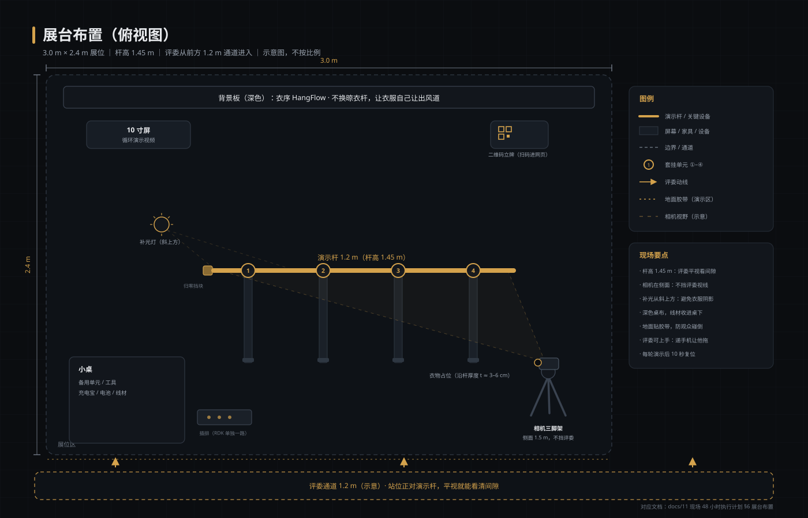

# 现场 48 小时执行计划（12.05 13:00 — 12.07 18:30）

> **这份文档回答：到了现场，每小时谁在做什么，什么情况下砍功能。**
> 现场时间比代码贵，**决策必须提前写好**，不要临场吵。

---

## 0. 三条铁律

1. **P0 没通，不碰 P1。** 演示"能跑的核心"比"半成品的功能全家桶"值钱。
2. **每 4 小时一个门禁**，不达标立刻降级，不解释、不硬扛。
3. **演示前 2 小时冻结代码/机械**，只排练。改一个变量就可能毁掉整场。

---

## 1. 总时间轴

```
12.05 周六
 13:00  签到、领硬件、找工位
 14:00  布场（电源/网络/相机/展示台）
 15:00  机械装配（4 单元）
 18:00  单元上电、固件烧录、单模块动起来
 21:00  3 单元同时在线
 24:00  G1：至少 3 个单元可控移动

12.06 周日
 08:00  视觉标定 + 网页联调
 12:00  G2：一键等距（3 单元）跑通
 16:00  4 单元 + 智能分配 + 收衣
 19:00  G3：全流程连续 5 次成功
 21:00  功能冻结；排练 3 遍
 24:00  演示视频录制 + 备份

12.07 周一
 07:00  现场恢复（断电重启测试）
 09:00  彩排 2 遍；检查评委动线
 10:00  代码/机械冻结
 11:30  提交材料最后检查
 12:00  作品提交截止
 14:00  评审（作品前讲解 + 演示）
 18:30  决赛路演（若入围）
```

---

## 2. Day 1（12.05 周六）：把"能动"做出来

| 时间 | 任务 | 负责人 | 输出 | 风险 |
|---|---|---|---|---|
| 13:00 | 签到、领 RDK/硬件、确认工位电源 | 队长 | 工位号、硬件清单 | 排队久 → 一人排队一人先布场 |
| 13:30 | 布场：桌子、插排、演示架、相机三脚架 | 机械+产品 | 展台雏形 | 桌面不平 → 垫纸/调脚 |
| 14:30 | RDK 上电、连屏、系统检查（`ip a`、`lsusb`） | 软件 | 能 SSH/远程 | 供电不足 → 换 65W PD |
| 15:00 | 机械装配第 1 个单元（打印件 + 电机 + 轴承） | 机械 | 单元 #1 实物 | 打印件公差 → 锉刀修 |
| 16:00 | 电控接线（ESP32+DRV8833+编码器+电池） | 电控 | 单元 #1 通电 | 烧板 → 换备用 |
| 17:00 | 固件烧录、串口调电机正反转 | 电控 | 轮子转 | 编码器方向反 → 改符号 |
| 18:00 | 单模块闭环：串口 `move 200` 走 20cm | 电控 | 位移误差 <10mm | 打滑 → 加弹簧/换轮 |
| 19:00 | 装配 #2—#4（流水：机械装壳、电控接线） | 全员 | 4 个单元 | 零件不够 → 先保 3 个 |
| 21:00 | 3 单元同时上电、MQTT 上线、网页看到状态 | 软件 | 状态面板 | Wi-Fi 干扰 → 换信道 |
| 22:30 | 场景联排（手动推、急停） | 全员 | 3 单元可控 | — |
| 24:00 | **G1 门禁** | 队长 | 见下 | — |

**G1 判据**：≥3 个单元能通过网页/串口移动 20cm，误差 <10mm；急停有效。
**不通过**：12.06 上午只做 G1，砍掉视觉；12.06 下午仍不通 → 降级到 2 单元 + 手动模式。

---

## 3. Day 2（12.06 周日）：把"智能"接上

| 时间 | 任务 | 负责人 | 输出 | 风险 |
|---|---|---|---|---|
| 08:00 | 相机固定、内参载入、杆轴标定 | 软件 | 4 个标记有读数 | 逆光 → 拉窗帘/补光 |
| 09:30 | 视觉 → 规划 → 指令联调 | 软件 | 点网页，单元动 | 坐标符号反 → 核对左右 |
| 11:00 | 一键等距（3 单元） | 软件 | 3s 内排开 | 串行太慢 → 并发+ToF |
| 12:00 | **G2 门禁**：等距连续 3 次成功 | 队长 | — | — |
| 13:00 | 第 4 单元上线 | 电控 | 4 单元 | 电池不够 → 换电 |
| 14:00 | 智能分配（湿度权重） | 软件 | 湿的间隙大 | 权重不明显 → 调参数 |
| 15:30 | 收衣模式 + 智能分配演示 | 软件 | 收拢到一端、湿的间隙大 | 效果不明显 → 只演示等距 |
| 17:00 | 网页美化（金色/数字/动画） | 产品 | 可给评委看 | 别改结构，只改样式 |
| 18:00 | 全流程串演 3 遍 | 全员 | 记录问题 | — |
| 19:00 | **G3 门禁**：全流程连续 5 次成功，无人工干预 | 队长 | — | — |
| 20:00 | 演示脚本定稿 + 排练（含讲解词） | 全员 | 打印脚本 | — |
| 21:00 | **功能冻结**（不再加功能） | 队长 | git tag | — |
| 22:00 | 录演示视频（3 遍取最好） | 产品 | MP4 备份 | — |
| 24:00 | 收工；电池全部充电 | 电控 | 满电 | — |

**G3 判据**：从「4 件挤在一起」到「一键排开 + 收衣 + 急停复位」，全程 ≤90 秒，连续 5 次不失败。

---

## 4. Day 3（12.07 周一）：交付与答辩

| 时间 | 任务 | 负责人 | 备注 |
|---|---|---|---|
| 07:00 | 断电重启测试（拔插排→等 40s→网页可开） | 软件 | 必须通过 |
| 08:00 | 现场恢复 + 桌面整理 + 补光 | 全员 | 桌面只放必需品 |
| 09:00 | 彩排 2 遍（含评委视角：走位、递话筒、屏幕角度） | 全员 | 录像回看 |
| 10:00 | **代码/机械冻结** | 队长 | 只允许改配置 |
| 10:30 | 提交材料检查（仓库、文档、视频、AI 记录） | 产品 | 清单见 §8 |
| 11:30 | 充电宝/电池/备用件最后检查 | 电控 | — |
| 12:00 | **提交截止** | 队长 | 提前 30 分钟提交 |
| 13:00 | 午餐 + 休息（答辩前不熬夜） | 全员 | — |
| 14:00 | 评审：讲解 + 演示 + 问答 | 队长主答 | 脚本见 [docs/12](12-演示脚本与答辩.md) |
| 17:30 | 若入围：决赛路演准备（3 分钟版） | 队长 | — |
| 18:30 | 决赛路演与颁奖 | 全员 | — |

---

## 5. 分工矩阵（现场）

| 任务 | 主 | 备 | 说明 |
|---|---|---|---|
| 机械装配/修件 | 机械 | 电控 | 打印件、螺丝、夹爪 |
| 接线/烧录/电源 | 电控 | 机械 | 现场唯一焊工 |
| 视觉/规划/网页 | 软件（队长） | 产品 | 代码改动唯一出口 |
| 演示讲解 | 队长 | 产品 | 只有一个人主讲，避免抢话 |
| 拍摄/记录 | 产品 | — | 过程素材=AI/开发过程证据 |
| 评委接待/答疑 | 产品 | 队长 | 技术问题转队长 |

**沟通**：每 4 小时站会 5 分钟（12:00 / 18:00 / 24:00）；用飞书群同步进度；**任何"我要改架构"的提议，队长一票否决直到 G3。**

---

## 6. 展台布置（提前画好）

```
         ┌──────────────── 背景板（深色）────────────────┐
         │  衣序 HangFlow · 不换晾衣杆，让衣服让出风道   │
         │                                              │
         │   [10 寸屏：循环演示视频]   [二维码立牌]       │
         │                                              │
         │        ┌──── 演示杆 1.2m（高 1.5m）────┐      │
         │        │  ①②③④  → 衣服                   │      │
         │        └────────────────────────────────┘      │
         │   [三脚架相机]        [小桌：备用单元/工具]     │
         └──────────────────────────────────────────────┘
              ▲ 评委站在这一侧（留 1.2m 通道）
```

要点：
- 杆高 1.4—1.5m，评委平视能看到间隙；不要太高挡脸。
- 相机在侧面 1.5m，不挡评委视线；用黑色三脚架。
- 补光灯从斜上方打，避免衣服阴影导致标记过暗。
- 桌布深色，线材用魔术贴收在桌下。
- 地上贴一条胶带"演示区"，防止观众碰倒。



> 图为示意：杆、4 个单元、三脚架相机、屏幕、二维码、补光、评委通道的位置关系。

---

## 7. 现场环境应对

| 问题 | 对策 |
|---|---|
| Wi-Fi 2.4G 拥挤（几十队） | 赛前扫信道选最空；RDK 热点隐藏 SSID；单元固定 IP；备用手机热点 |
| 电源不稳/插排不够 | 自带 3m 插排 + 65W PD；RDK 单独一路；电池供电的单元不受影响 |
| 桌面震动/观众碰 | 演示杆底座加重（书/水壶压）；胶带标记位置 |
| 灯光频闪 | 相机手动曝光；避开顶灯直射 |
| 噪音大听不见蜂鸣 | 依赖 LED + 网页提示 |
| 评委要求"再演示一遍" | 每次演示后 10 秒复位（归零），脚本里写清 |

---

## 8. 提交材料清单（12.07 11:30 前）

- [ ] GitHub 仓库：README、docs、代码、CAD、BOM、演示视频链接
- [ ] 一页纸方案（PDF，打印 3 份放展台）
- [ ] 现场演示视频（2 分钟，U 盘 + 云备份）
- [ ] AI 使用记录（截图/日志/commit 标注，见 [docs/16](16-AI辅助开发与过程证据.md)）
- [ ] "赛前基础 vs 现场新增"说明（1 页）
- [ ] 团队信息、设备清单、开源许可证清单
- [ ] 答辩 PPT（10 页，见 `deck/`）

---

## 9. 睡眠与体力（别逞强）

- 12.05 晚：机械/电控留到 24:00，其余人 23:00 撤；
- 12.06 晚：最多到 24:00，**必须有人睡够 6 小时**（第二天主讲的人优先睡）；
- 现场带：水、能量棒、眼药水、创可贴、充电线。
- **不要在答辩前夜通宵改代码**——历史上通宵改出来的都是 bug。

---

## 10. 突发情况预案（30 秒决策表）

| 情况 | 立即动作 | 谁决定 |
|---|---|---|
| 单元冒烟/发烫 | 断电、拔电池、移出桌面 | 电控 |
| 衣服掉落/杆倒 | 先扶杆，再停系统；不抢在运动时扶 | 机械 |
| 网页打不开 | 笔记本本地打开备份 HTML（mock 数据） | 软件 |
| 视觉全丢 | 切"里程计模式"，讲解"视觉降级" | 软件 |
| 评委提前来 | 先讲 30 秒 + 演示已就绪的部分，不现场 debug | 队长 |
| 时间不够 | 按 §11 砍功能 | 队长 |

---

## 11. 功能降级阶梯（从上往下砍）

```
L0 全功能：4 单元 + 视觉闭环 + 智能分配 + 收衣 + 网页
L1 砍智能：4 单元 + 视觉 + 等距 + 收衣（不按湿度加权）
L2 砍视觉：纯编码器 + 手动/等距（精度 ±15mm）
L3 砍智能：3 单元 + 手动 + 收衣（网页只显示状态）
L4 砍到 2 单元：单向等距演示（"概念验证"）
L5 静态展示：实物 + 视频 + 网页 mock（不现场运动）
```

**每一级都能讲一个完整故事**——这是提前设计好的，不是失败。

---

## 12. 评委动线（评审 14:00 开始）

1. 评委走近 → 产品同学递 A5 卡 + 一句话；
2. 队长 60 秒讲：问题（10s）→ 方案（20s）→ 现场演示（20s）→ 数据/成本（10s）；
3. 评委提问 → 技术问题队长答，商业问题产品答，不抢答；
4. 评委想自己操作 → 递手机/指向网页，"您可以拖一下这个模块"；
5. 结束 → 递名片/二维码/仓库链接。

> 不要拦住评委讲 10 分钟。**评委时间有限，前 30 秒决定印象。**

---

## 13. 赛后 24 小时

- 导出日志、照片、视频，归档到仓库 `assets/event/`；
- 写复盘（什么有效、什么浪费、下次怎么改）；
- 给队友发感谢 + 分工贡献记录（评奖/简历用）；
- 若获奖：准备媒体素材（产品图、演示 GIF、一句话介绍）。
