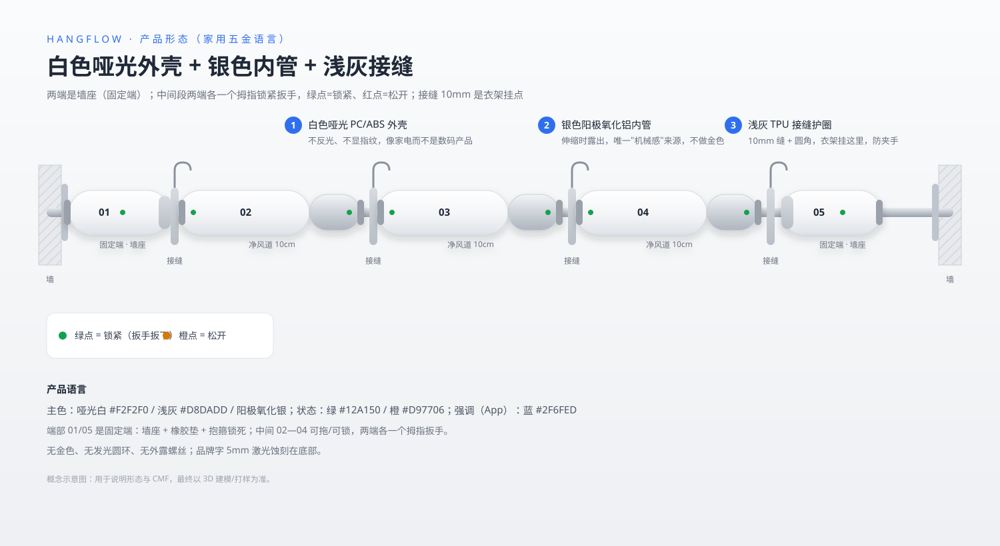

# v2 总览与架构：伸缩圆柱链（双端锥面收口夹头版）

> **这份文档回答：v2 到底是什么、为什么这么设计、系统怎么搭。**
> 概念修正：2026-11-23（用户两次纠正：①衣架不挂在调节器上；②排列是"墙—调节器—衣物—…—调节器—墙"，K 件衣服 = K+1 个调节器，每个调节器有一对锥面收口夹头（两端各一））。
> v1 文档保留作历史，**以本文为准**。

---

## 1. 一句话

**在现有晾衣杆上，按"墙/边缘—调节器—衣物—调节器—衣物—…—调节器—墙/边缘"串起 K+1 个抱箍式伸缩圆柱；衣架挂在相邻两个调节器端头的 10mm 接缝里。圆柱伸长 → 把两边衣服推开；缩短 → 让它们靠拢。调节器不承重、不挂衣服。**



五个关键事实：

1. **衣服还挂在原来的杆上**——衣架钩在接缝里，承重的是杆，不是调节器。
2. **一个内部调节器 = 一段净风道**——圆柱多长，两件衣服之间就多宽（衣架按 1cm 厚计）。
3. **K 件衣服配 K+1 个调节器**——两端也各有一个；4 件衣服 = 5 个调节器（2 端 + 3 内）。
4. **每个调节器有一对锥面收口夹头（两端各一）**——锁一端 = 单向伸缩；锁两端 = 定点拉伸/绝对位置；两端调节器顶墙预紧（不再用卷簧）。
5. **不换序**——衣架/圆柱跨不过彼此；每个圆柱有唯一编码，RDK 视觉**智能识别**谁在哪。

---

## 2. 为什么这个形态比 v1 好

| 维度 | v1（自走模块，衣架挂在模块上） | v2（伸缩圆柱链） |
|---|---|---|
| 承重 | 模块扛 5kg 湿衣，摩擦轮牵引 | **衣服挂在杆上，调节器只推 10—20N** |
| 打滑 | 摩擦轮打滑，靠视觉校正 | **无摩擦轮；长度由丝杆/AS5600 直接测** |
| 成本 | 4 模块 ×¥150 | **K+1 圆柱 ×¥90—95** |
| 控制 | 位置闭环 + 视觉 | **长度闭环 + 锥面收口夹头定点** |
| 安装 | 夹在杆上 | 抱箍两半扣上，同样不拆杆 |
| 增删 | 加模块 | 加一件 = 加一个衣架 + 一个调节器 |
| 换序 | 物理不可能 | 物理不可能 + 编码固定（不换序） |

---

## 3. 几何与公式（锁定）

| 符号 | 含义 | 值 |
|---|---|---|
| `K` | 衣服件数 | 2—8（演示 4） |
| `K+1` | 调节器数量（两端各一个） | 演示 5 |
| `t_h` | 衣架 + 衣物沿杆厚度 | **10 mm（1cm）** |
| `L_i` | 第 i 个调节器长度，i=0…K | 内部动力段 100—220mm（40—100 用被动短套）；端部段 30—120mm |
| `g_i` | 第 i 与 i+1 件之间的净风道 | `g_i = L_i`（内部段） |
| 总链长 | `Σ_{i=0}^{K} L_i + K×10mm` | 演示 460mm |

**位置递推**（从左墙/挡块起）：

```
x_cloth1 = L_0 + t_h/2
x_cloth(i+1) = x_cloth(i) + t_h + L_i        (i = 1…K−1)
末调节器 L_K 接右墙/挡块，用于端部余量与预紧
```

**演示算例**：K=4；内部净风道 10cm → L1=L2=L3=100mm；端部 L0=L4=60mm；总链长 `60+100+100+100+60 + 4×10 = 460mm`。1.2m 杆剩余长度由端部调节器伸出顶墙补偿（预紧 5—10mm）。

**可行性**：`ΣL + K×10mm + 安装余量 ≤ 可用杆长`；否则提示"减少衣服/加长杆"。

---

## 4. 单元解剖（一个调节器）

```
   左夹持件                            右夹持件
      │                                   │
 ┌────┴───────────────────────────────────┴────┐
 │ 外套管（电控/电池）                          │
 │    ┌──────────────────────────────────┐     │
 │    │ 内套管（丝杆螺母，伸缩）           │     │
 │    └──────────────────────────────────┘     │
 └─────────────────────────────────────────────┘
      ▲ 抱箍两半扣在杆上（不拆杆）
      ▲ N20 电机 + T8 梯形丝杆 + AS5600
      ▲ ESP32-C3 + 1000mAh 18650 + USB-C
      ▲ 两端夹持件（锥面收口夹头 + 微动开关）
```

| 部件 | 作用 | 关键设计 |
|---|---|---|
| 抱箍两半 | 挂在杆上，不拆杆 | 铰链+卡扣；TPU/PTFE 内衬 |
| **锥面收口夹头（双端）** | 固定绝对位置/选择单向伸缩 | 锥面收口夹头：开槽夹头环 + 外套筒，套筒轴向内滑 5—8mm，锥面径向压紧杆；反向拉出松开；夹持力 ≥40N；微动开关反馈锁/松 |
| 外套管 | 固定段/电控仓 | Ø42—46mm，PETG/ASA |
| 内套管 | 伸出段 | 同轴，间隙 ≤0.15mm，防转筋 |
| 丝杆+螺母 | 旋转→直线 | T8 梯形丝杆，导程 8mm（四头）；自锁/刹车 |
| 电机 | 驱动 | N20 6V 30rpm，额定 ≥0.1N·m |
| 长度传感 | 闭环 | AS5600 装丝杆轴，4096 计数/转 |
| 端头 U 托 | 10mm 接缝，托住衣架钩 | 圆角、防夹手 |

**锥面收口夹头怎么用**：

- 只锁左端、松右端 → 伸长时右端单向伸出（推右边衣架）；
- 只锁右端、松左端 → 左端单向伸出；
- 两端都锁 → 长度/位置固定（绝对定位，可长期保持）；
- 两端都松 → 整段可沿杆滑动/取下。

**为什么不用卷簧**：每个调节器两端有锥面收口夹头，可锁在杆上任意位置；端部够到墙时顶墙预紧，够不到就锁杆。链靠夹头定位，不靠弹簧保持贴合。

---

## 5. 系统架构

```
┌──────────────── 手机网页（扫码）────────────────┐
│ 手动逐段 / 一键等距 / 按湿度加权 / 收衣 / 急停    │
└───────────────────┬─────────────────────────────┘
                    │ HTTP + WS（RDK 热点）
┌───────────────────┴─────────────────────────────┐
│ RDK X5：USB 相机 → ArUco 识别 ID/位置 → 链模型   │
│         → 长度规划 → MQTT；FastAPI 网页/日志     │
└───────────────────┬─────────────────────────────┘
                    │ Wi-Fi 2.4G / MQTT
   ┌──────────┬─────┴──────┬──────────┬──────────┐
   │ 调节器0  │ 调节器1    │ 调节器2  │ …        │
   │ ESP32-C3 │ ESP32-C3   │ ESP32-C3 │          │
   │ N20+丝杆 │ N20+丝杆   │ N20+丝杆 │          │
   │ AS5600   │ AS5600     │ AS5600   │          │
   │ 双端锥面收口夹头 │ 双端锥面收口夹头   │ 双端锥面收口夹头 │          │
   └──────────┴────────────┴──────────┴──────────┘
```

- **中枢**：读 ID（智能识别谁在哪）、算每段目标长度、发指令、显示状态；不直接驱动电机。
- **单元**：收 `set_length_mm` + `clamp` 指令；本地闭环；上报长度/夹持状态/电流/电量。
- **视觉**：读 ArUco ID + 圆柱中心；接缝 = 两圆柱端点之间；衣架中心 = 接缝中心；失败时用长度反馈。

---

## 6. 四种模式

| 模式 | 行为 | 现场用途 |
|---|---|---|
| **手动逐段** | 选第 i 段；选锁哪端；滑杆调长度 | 评委自己拖 |
| **一键等距** | 内部段设目标净风道（默认 10cm）；端部段保持预紧 | 主演示动作 |
| **按湿度加权** | 湿的段更长、干的段更短；总长不超可用 | 技术亮点 |
| **收衣** | 内部段缩到最短；端部段回缩；衣架靠拢到一侧 | 收衣演示 |

**调节顺序**（推荐）：

1. 端部段先锁外端、伸出顶墙预紧；
2. 内部段从右到左：锁左端、伸右端（或锁右端、伸左端），每段到位后两端锁死；
3. 收衣反向：先解内部段右端，缩，再解左端。

> 双端锥面收口夹头的意义：每一步只有一端是自由的，**不会推着整条链跑**；绝对位置由夹持点确定。

---

## 7. 控制与安全

```
RDK 规划 L_i* + clamp 策略 → MQTT → ESP32 本地长度 PID（AS5600）→ 丝杆
                                     ← length_mm / clamp_state / current / state
视觉每 300ms 读 ID/位置 → 与模型比对 → 修正 L_i*
```

| 风险 | 判据 | 动作 |
|---|---|---|
| 丝杆卡死 | PWM 在给、AS5600 300ms 不动 | 停 + 回退 2mm + 红灯 |
| 超行程 | L < 30 或 > 220mm | 硬件限位 + 软件限位 |
| 夹手 | 接缝 10mm/夹持件处 | 圆角 + 电流阈值 + 急停 |
| 未锁就伸缩 | 夹持微动为"松"时收到 set_length | 拒绝执行 + 提示"先锁端" |
| 断网 | 500ms 无心跳 | 保持长度（丝杆自锁/刹车），不瞎动 |
| 低电 | <3.4V | 只允许收衣 |
| 链超长 | ΣL + K×10 > 可用 | 拒绝执行，提示减件/加长杆 |

---

## 8. P0 / P1 / P2

| 级别 | 内容 |
|---|---|
| **P0（现场必须）** | 5 个调节器（2 端 + 3 内）+ 4 衣架在 1.2m 杆；双端锥面收口夹头（手动凸轮 + 微动）；手动逐段、一键等距、收衣；网页；急停；ArUco 识别 5 个 ID；长度误差 ≤3mm |
| **P1** | 按湿度加权；视觉闭环；杆长 1.8m；电动夹持；加/减一件（加 1 接缝 + 1 调节器） |
| **P2** | BPU 衣物识别/湿度估计；多杆联动；接升降晾衣架 |

---

## 9. 关键指标（设计值）

| 指标 | 目标 |
|---|---|
| 调节器数量 | 3—9（K+1，K=2—8） |
| 内部段长度 | 40—220mm |
| 端部段长度 | 30—120mm |
| 净风道 | 4—22cm |
| 长度精度 | ±2mm（AS5600）/ ±3mm（视觉校正后） |
| 伸缩速度 | 3—8mm/s（T8 8mm 导程 + 30rpm ≈ 4mm/s） |
| 单圆柱推力 | ≥30N |
| 夹持力 | ≥40N/端 |
| 单圆柱重量 | ≤180g（含电池） |
| 单圆柱续航 | 待机 ≥24h / 动作 ≥1000 次（1000mAh，估算） |
| 单圆柱成本 | 内部段 打样 ≤¥100 / 量产 ≤¥83；端部段 ≤¥75 / ¥62（含双端锥面收口夹头） |
| 整机（5 圆柱 + 相机 + 杆，不含 RDK） | 打样 ≤¥575；含 RDK 账面 ≤¥1,120 |

---

## 10. 与 v1 的复用与废弃

**复用**：RDK 平台与部署（docs/17）、视觉标定/ArUco、MQTT/网页框架、赛程/风险/答辩方法、加权分配思想。
**废弃**：自走模块、摩擦轮、ToF 邻距、重排、模块承重、v1 机械/电控/BOM/交互/deck。
**历史**：v1 文档保留，v1 的教训写在 README 与本文 §2。

---

## 11. 最大的三个风险

1. **双端锥面收口夹头松脱/打滑**：夹持力 ≥40N、凸轮自锁、微动开关校验；赛前做 10 次拆装 + 20N 拉力。
2. **丝杆卡死/自锁不足**：T8 梯形丝杆 + 自锁/刹车；卡死判据 300ms；先手动转 100 次。
3. **接缝夹手/衣架脱缝**：10mm 缝 + 圆角 U 托 + 电流限制；标准衣架钩 4mm 线径实测；50 次挂取。


