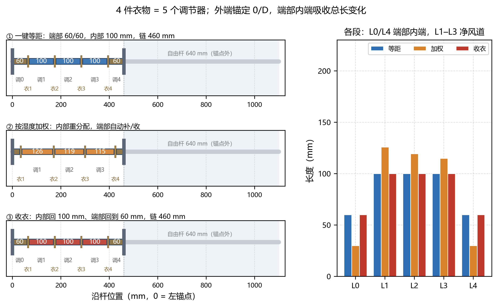
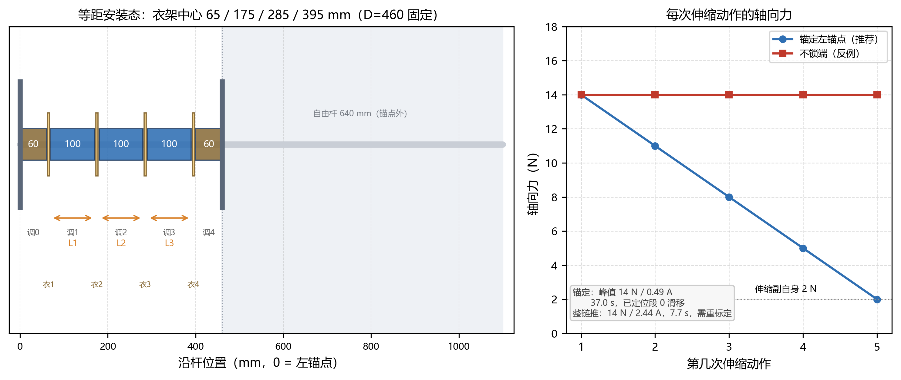
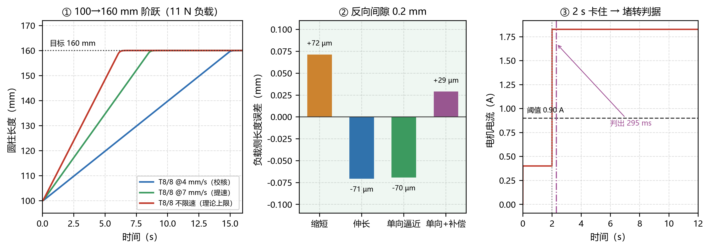
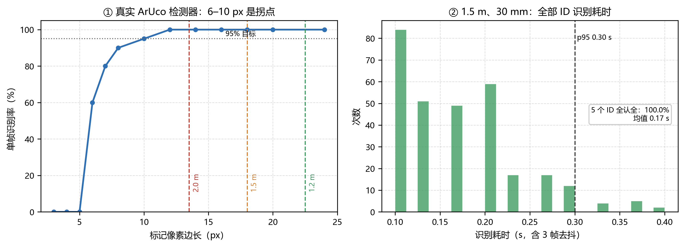

# 算法与控制（v2 · rev-E 最终机械口径）

> 这份文档回答：**衣序 v2 的间距怎么算、链怎么动、长度怎么闭环、误差怎么保证 ±2 mm**。
> 结构以 `docs/v2/10-端点锚定模型.md` 与机械最终口径为准：
> **K 件衣服 = K+1 个调节器**（两端各 1、内部 K−1）；内部动力段 **100–220 mm**（= 净风道），
> 端部 **30–120 mm**（外端锚定、内端自由伸缩），`D=460 mm` 默认；收衣 = 内部回 **100 mm**；
> 4–10 cm 由**被动短套**处理，不进自动规划；每个调节器用**锥面收口夹头**，取消恒力卷簧。
> 全部数字为**仿真/估算值，非实测**；明细见 `docs/_data-v2/results.md`，代码在 `sim-v2/`。

---

## 0. 先看结论

1. **默认安装态**：`[60, 100, 100, 100, 60] mm`，D=**460 mm**，链长 460 完全贴合，锚点 0/460 不动；
   锚点外还剩 **640 mm 自由杆**（夹头锁位区）。
2. **端部内端吸收总长变化**：等距 12 cm → `[30,120,120,120,30]`（Δ=+60，端部各 −30）；
   收衣 → `[60,100,100,100,60]`（内部回 100、端部回 60）。链长始终 460。
3. **拒绝是明确的**：目标 8 cm（低于动力段下限 100 mm）→ 拒绝并说明用被动短套；
   目标 15 cm（端部需 60−75 < 30 下限）→ 拒绝；目标 20 cm（内部 600 mm 超过 D）→ 拒绝。
4. **调节顺序**：锚定左锚点、从左往右逐段「先锁靠基准侧夹头 → 伸缩自由端 → 锁死另一端」。
   峰值 **14 N / 0.49 A**；不锁端整链推 14 N / 2.44 A，且已定位衣架全部滑移、要重标定。
5. **耗时**：日常（12 cm→收衣，5 段都动、行程 120 mm）4 mm/s 校核 **37.0 s**（超 30 s）、
   7 mm/s **24.1 s**（达标）；安装标定（端部 30→60）一次性 **21 s**。
6. **长度闭环**：100→160 mm 阶跃，4 mm/s 上升 **12.0 s**、稳态误差 **+0.02 mm**、超调 0.02 mm；
   7 mm/s 6.9 s；不限速 4.9 s；0.2 mm 反向间隙残余 ≤±72 µm；堵转 **295 ms** 判出。
7. **误差预算 ±2 mm 可达**：RSS **0.53 mm**、最坏叠加 0.87 mm，MC 2 万次 100% 落在 ±2 mm 内；
   最大项是衣架/端面定位公差 0.5 mm（占方差 90%），视觉 2 mm 不进闭环。

---

## 1. 符号与约束

| 符号 | 含义 | 值 |
|---|---|---|
| `K` | 衣物件数 | 演示 4（2–8） |
| `K+1` | 调节器数量 | 演示 5（两端各 1） |
| `t_h` | 衣架沿杆厚度（含衣物压扁） | 10 mm |
| `L_i` | 内部动力段 = 净风道 | **100–220 mm** |
| `L_0, L_K` | 端部内端长度（外端锚定） | **30–120 mm**，默认 60 |
| `D` | 外端锚点间距（固定） | **460 mm**（1.2 m 杆、4 件、10 cm 风道） |
| 可用长度 | 杆长 − 2×50 mm | 1.2 m 杆 → 1100 mm |
| 自由杆 | 可用长度 − D | 640 mm（锚点外锁位区） |

约束：外端坐标 `0`、`D` 固定；`ΣL + K·t_h` 必须等于 D（等距/加权），
收衣时也等于 D（内部回 100、端部回 60）。端部超限或内部超限 → 拒绝并给原因。
4–10 cm 用被动短套（不计入本规划器）。

---

## 2. 长度规划（`sim-v2/length_planner.py`）

### 2.1 三种模式

1. **等距**：`L_i = g_target`（默认 100 mm；可 100–220）。
2. **按湿度加权**：内部总风道不变（演示取 12 cm 平均预算），按权重重分配：
   `a_i = ((q_i+q_{i+1})/2)^γ + ε`，`L_i = L_min + E·a_i/Σa`；有上限做比例注水 + 饱和。
3. **收衣**：内部全部回 `L_min = 100 mm`，端部回 60 mm。

### 2.2 端部吸收（端点锚定）

```text
Δ = Σ(新内部段 − 当前内部段)
两端各吸收 −Δ/2：L0' = L0 − Δ/2，LK' = LK − Δ/2，各自 clamp 30–120
一端到限位 → 另一端补；两端都不够 → rejected
最后按 D 拟合：L0 + LK = D − K·t_h − ΣL（D 被钳制时也对得上）
```

### 2.3 验收用例（`docs/v2/10 §5` + 最终口径）

| 场景 | L0/L1/L2/L3/L4 (mm) | 链长 (mm) | 状态 |
|---|---|---|---|
| 默认（等距 10 cm） | 60 / 100 / 100 / 100 / 60 | 460 | ok |
| 等距 12 cm | 30 / 120 / 120 / 120 / 30 | 460 | ok |
| 收衣（内部回 100） | 60 / 100 / 100 / 100 / 60 | 460 | ok |
| 目标 8 cm | — | — | rejected（低于动力段下限，用被动短套） |
| 目标 15 cm | — | — | rejected（端部超下限） |
| 目标 20 cm | — | — | rejected（内部超过锚定跨度） |



*图 v2-01：锚点 0/D 固定；等距与收衣都是 [60,100,100,100,60]，加权只重分内部段。*

容量：1.2 m 杆 10 cm 风道，端部 60 时最多 **9 件**（端部压到 30 时 **10 件**）；
K=10 时名义 D=1120 > 可用 1100，规划器会钳到 1100、端部自动变 50/50 并告警，不崩。
规划耗时：K=4 中位 **52 µs**、K=10 约 60 µs。

---

## 3. 链几何与夹持顺序（`sim-v2/chain.py`）

### 3.1 位置递推

```text
调节器 i 占 [x_i, x_i + L_i]；x_0 = 0（左锚点）；调节器 K 的右端固定在 D
衣物 i 中心 = x_i + L_i + t_h/2
x_{i+1} = x_i + L_i + t_h
链长 = ΣL + K·t_h = D；空杆 = D − 链长（收衣到最短仍为 0）
```

等距数值例子：调节器区间 `[0,60] [70,170] [180,280] [290,390] [400,460]`，
衣架中心 **65 / 175 / 285 / 395 mm**，中心距 110 mm；12 cm 时端部 30，
右端部内端 430、链末端 430。

### 3.2 夹持机制：锥面收口夹头

每端是**锥面收口夹头**：开槽夹头环 + 外套筒；套筒**向内滑 5–8 mm**，
锥面把开槽环径向压紧在杆上（不是爪子、不是凸轮）。算法状态只有 `lock / free`：

- 端部外端：**永远锁**（锚点 0/D 不动）；
- 端部内端：默认自由，长度 30–120；
- 内部段两端：锁一端 = 自由端伸缩，锁两端 = 长度固定。

### 3.3 调节顺序（先锁哪端、再伸缩哪端）

```text
以左锚点为基准，从左往右逐段：
  1) 锁靠基准侧的夹头（反作用进杆，已定位段不动）
  2) 伸缩自由端到目标 L_i（只推动相邻那一件衣架）
  3) 锁另一端（绝对长度，不依赖链条张力）
端部有动作时最后补一个 0.5 mm 压紧动作
```

| 策略 | 总耗时 (s) | 峰值力 (N) | 峰值电流 (A) | 已定位段滑移 | 需重新标定 |
|---|---|---|---|---|---|
| 锚定左锚点（推荐） | 37.0 | 14 | 0.49 | 0 | 否 |
| 锚定右锚点 | 37.0 | 14 | 0.49 | 0 | 否 |
| 不锁端（整链推） | 7.7 | 14 | 2.44 | 整链滑移 | 是 |



*图 v2-02：锚点 0/D 固定；锚定策略力值 14→11→8→5 N 递减，不锁端恒 14 N 且要重标定。*

### 3.4 日常 vs 安装

| 工况 | 行程 | 4 mm/s 校核 | 7 mm/s 提速 |
|---|---|---|---|
| 日常（12 cm→收衣，5 段） | 120 mm | **37.0 s**（超 30 s） | **24.1 s** ✓ |
| 安装标定（端部 30→60、内部 100 不变） | 60 mm | 21 s（一次性） | 13 s |


*图 v2-03：日常耗时 vs K。4 mm/s 超 30 s，7 mm/s 达标 → 驱动按 ≥7 mm/s 选。*

---

## 4. 长度闭环控制（`sim-v2/length_control.py`）

模型：N20 + T8 导程 8 mm（η=0.35）、AS5600 12 bit/圈（分辨率 2 µm）、
负载 11 N（日常）/14 N（安装）、反向间隙 0.2 mm、编码器噪声 0.01 mm、
堵转判据「电流 > 0.90 A 且 0.3 s 无位移」。

| 驱动 | 上升 10–90% (s) | 稳定 2% (s) | 超调 (mm) | 稳态误差 (mm) |
|---|---|---|---|---|
| T8/8 @4 mm/s（校核） | 12.0 | 14.57 | 0.02 | +0.016 |
| T8/8 @7 mm/s（提速） | 6.9 | 8.35 | 0.03 | +0.029 |
| T8/8 不限速（理论上限） | 4.9 | 5.99 | 0.04 | +0.037 |

反向间隙：缩短 +72 µm、伸长 −71 µm、单向逼近 −70 µm、单向+补偿 +29 µm
（标定后 ≤±72 µm，不是预算主项）。
堵转：2 s 时卡住，电流升到 1.83 A，**295 ms** 判出并回退 2 mm。



*图 v2-04：阶跃、反向间隙、堵转判据。*

---

## 5. 误差预算（±2 mm）

| 误差项 | ±值 (mm) | 依据 |
|---|---|---|
| 衣架/端面定位公差 | 0.50 | 调节器自由端面与衣架钩贴合（最大项，占方差 90%） |
| 夹持重复定位 | 0.10 | 锥面夹头重夹的位置重复性 |
| 温度漂移 | 0.10 | −5–45 °C |
| 端部预紧变形 | 0.05 | 10 N 压紧下的弹性压缩 |
| 反向间隙（补偿后） | 0.04 | 仿真残余 |
| 丝杆导程误差 | 0.037 | T8 轧制 ±0.05/300 mm |
| 控制稳态误差 | 0.03 | 仿真 |
| AS5600 分辨率 / 噪声 | 0.012 | 12 bit + 抖动 |
| **RSS 合成** | **0.53** | 各项独立 |
| **最坏叠加** | **0.87** | 同向相加（保守） |

视觉定位 2 mm 只用于 ID 校验与显示，不进 L_i 闭环。MC 2 万次：p95 |e| 0.52 mm、
99.9% 分位 0.86 mm、**100% 在 ±2 mm 内**。若衣架/端面公差放到 2 mm，RSS 涨到 2.05 mm，
所以机械上先保证端面贴合 0.5 mm。


*图 v2-05：误差来源与蒙特卡洛。*

---

## 6. 视觉：ArUco 只做 ID 识别 + 位置校验（`sim-v2/vision_id.py`）

- 每个调节器唯一 ArUco（01–0K+1）；相机 1280×720、f=900 px、30 mm 标记：
  1.2 m → 22.5 px、1.5 m → 18 px；真实检测器 6–10 px 才掉率，余量 2 倍以上；
- 遮挡 8%/帧 + 3 帧去抖：5 个 ID 全认全 **100%**、p95 **0.30 s**；
- 降级：缺段 → 长度反馈 + 固定顺序；全认不出 → 保持上次绑定；重复 ID/倒挂 → 判误读丢弃。



*图 v2-06：识别率曲线 + 全部 ID 识别耗时。*

---

## 7. 与 v1 的关系 & 接口

| v1 | v2（rev-E） | 处理 |
|---|---|---|
| 衣架挂自走模块 | 衣架挂两调节器之间，调节器不承重 | 重写 |
| 4 模块 / 1.2 m | K+1 调节器（4 件 → 5 个） | 重写 |
| 间距规划 water-filling | 同一套数学，变量 `g_i → L_i`，端部吸收总长 | **复用** |
| 重排 move-to-end | 不换序 + 唯一编码 | 删除 |
| ArUco 定位 | ArUco 只做 ID 识别 + 位置校验 | 改用途 |
| 卷簧收 slack | 外端锚定 + 端部内端吸收 + 锥面夹头 | 删除卷簧 |

MQTT 下发建议：

```json
{"cmd":"set_gaps","targets":[{"id":"02","L_mm":120}],
 "anchor":{"left":0,"right":460},"clamp":"upstream",
 "order":["04","03","02","01"],"mode":"serial"}
```

`clamp` 指明锁哪端（上游/下游），`order` 是串行顺序；单元本地执行长度闭环，
中枢只下发目标；`anchor` 提醒端部外端不可动。

---

## 8. 复现与文件

```powershell
cd E:\D-robotics-ClothesRodHelper
python sim-v2/run_all.py     # 18 项单测 → 仿真 → 6 张图 → docs/_data-v2/results.md
python sim-v2/tests.py       # 只跑单元测试
```

| 文件 | 作用 |
|---|---|
| `sim-v2/length_planner.py` | 内部 100–220、端部 30–120、锚点吸收、拒绝原因 |
| `sim-v2/chain.py` | 链几何（锚点 0/D）、锥面夹头状态机、调节顺序与耗时 |
| `sim-v2/length_control.py` | 长度闭环、反向间隙、堵转、限位 |
| `sim-v2/vision_id.py` | ArUco 识别实验、ID 绑定、降级 |
| `sim-v2/error_budget.py` | ±2 mm 误差预算与蒙特卡洛 |
| `docs/_data-v2/results.md` | 参数/结果/结论总表（自动生成） |

---

## 9. 假设与局限

- 全部为仿真/估算：衣架滑动摩擦 3 N/件、副阻力 2 N、夹持动作 0.4 s、
  锥面夹头压紧行程 5–8 mm、预紧 10 N 都是设计估算，样机后实测替换。
- 内部动力段下限 100 mm 是机械口径；4–10 cm 用被动短套，**不参与自动规划**。
- D=460 是安装时定的锚点间距；端部内端 30–120，收衣/等距都在行程内。
- 视觉实验是合成图 + 真实检测器，未建模反光/逆光；识别率按 95% 目标留余量。
- 速度按 4 mm/s 校核时日常调整 37 s 超 30 s，7 mm/s 才达标（24.1 s）→
  电机/导程选型按 ≥7 mm/s 复核（T8 导程 8 mm + ≥50 rpm）。
