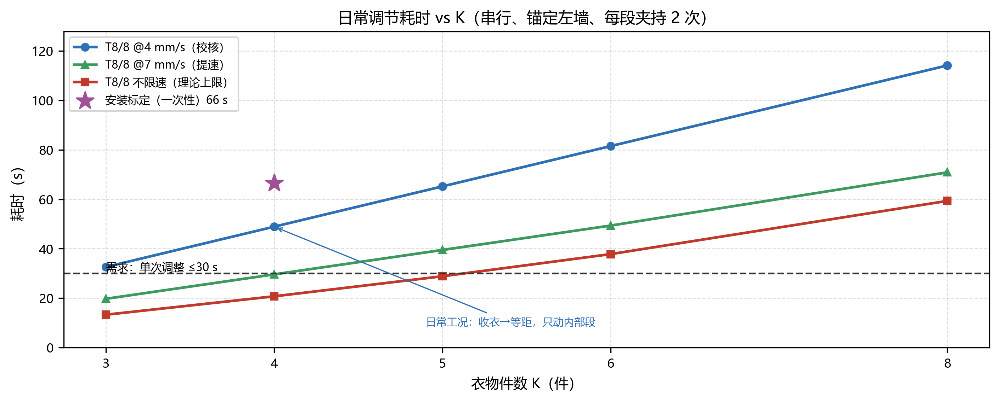
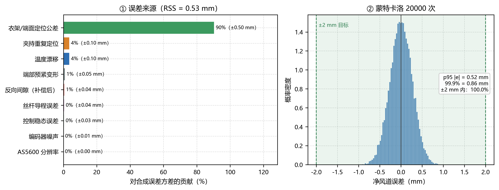

# 算法与控制（v2 · rev-C）

> 这份文档回答：**衣序 v2 的间距怎么算、链怎么动、长度怎么闭环、误差怎么保证 ±2 mm**。
> 结构口径以 `docs/_shared-context-v2.md` + 用户 2026-11-23 的三轮澄清为准：
> **K 件衣服 = K+1 个调节器**（两端各 1、内部 K−1），内部段长度 = 净风道，
> 端部段是安装配置值（**不填满杆**），每个调节器两端是**锥面收口夹头**，
> 取消恒力卷簧。全部数字为**仿真/估算值，非实测**，明细见
> `docs/_data-v2/results.md`，代码在 `sim-v2/`。

---

## 0. 先看结论

1. **间距 = 内部段长度**：4 件衣服配 5 个调节器，等距时
   `L0…L4 = [60, 100, 100, 100, 60] mm`，链长 **460 mm**，杆上剩 **640 mm 空杆**
   （端部夹头锁位区）。可行性只看 `ΣL + K·10 ≤ 可用长度`，不要求贴墙。
2. **端部不填杆**：端部段固定 60 mm（可配 30–120 mm），不负责吃掉杆长；
   `fill=True` 是可选模式（把余量补进端部），1.2 m 杆也补不满，程序会告警。
3. **调节顺序**：锚定左墙、**从左往右**逐段「先锁靠基准侧的夹头 → 伸缩自由端 →
   锁死另一端」。峰值轴向力 **11 N / 0.40 A**；不锁端整链推要 **14 N / 1.46 A**，
   且已定位衣架全部滑移、必须重新标定。
4. **耗时**：按 **T8 导程 8 mm、轴向 4 mm/s** 校核，日常（收衣→等距，只动内部 3 段）
   4 件要 **48.9 s**，**超 30 s**；提到 **7 mm/s** 后 **29.6 s** 达标 →
   驱动按 ≥7 mm/s 选。安装标定一次性 66.5 s。
5. **长度闭环**：4 mm/s 下 40→100 mm 上升 12.0 s、稳态误差 **+0.02 mm**、
   超调 0.03 mm；0.2 mm 反向间隙在负载侧只剩 ±72 µm；堵转 **295 ms** 判出。
6. **误差预算 ±2 mm 可达**：RSS **0.53 mm**、最坏叠加 0.87 mm，
   蒙特卡洛 2 万次 100% 落在 ±2 mm 内；最大项是**衣架/端面定位公差 0.5 mm**
   （占方差 90%），视觉 2 mm 不进闭环。

---

## 1. 符号与约束

| 符号 | 含义 | 值 |
|---|---|---|
| `K` | 衣物件数 | 演示 4（2–8） |
| `K+1` | 调节器数量 | 演示 5（两端各 1） |
| `t_h` | 衣架沿杆厚度（含衣物压扁） | 10 mm |
| `L_i` | 内部段 = 净风道 | 40–220 mm |
| `L_0, L_K` | 端部段 = 安装配置值 | 60 mm（可配 30–120） |
| 可用长度 | 杆长 − 2×50 mm 端部余量 | 1.2 m 杆 → 1100 mm |
| 链长 | `ΣL + K·t_h` | 等距 4 件 → 460 mm |
| 空杆 | 可用长度 − 链长 | 640 mm（端部夹头锁位区） |

可行性：`ΣL_i + K·t_h ≤ 可用长度`。**不要求等于**——端部段不负责填满杆。

---

## 2. 长度规划（`sim-v2/length_planner.py`）

### 2.1 三种模式

1. **等距**：`L_i = g_target`（默认 100 mm）。
2. **按湿度加权**：总风道不变，只重分内部段：
   `a_i = ((q_i + q_{i+1}) / 2)^γ + ε`，`L_i = L_min + E·a_i/Σa`；
   有 `L_max` 时做「比例注水 + 饱和」迭代（每轮至少饱和一段，最多 K−2 轮）。
3. **收衣**：内部段全部缩到 40 mm，端部保持配置值（不跟随）。

### 2.2 结果（4 件、1.2 m 杆）

| 模式 | L0 / L1 / L2 / L3 / L4 (mm) | 链长 (mm) | 空杆 (mm) |
|---|---|---|---|
| 等距 | 60 / 100 / 100 / 100 / 60 | 460 | 640 |
| 加权（湿度 0.55/0.90/0.35/0.75） | 60 / 117.6 / 97.7 / 84.7 / 60 | 460 | 640 |
| 收衣 | 60 / 40 / 40 / 40 / 60 | 280 | 820 |


*图 v2-01：三模式的段长与空杆。等距链长 460 mm，640 mm 是空杆/锁位区。*

容量：端部只占 2×60 mm 后，1.2 m 杆在 10 cm 风道下最多挂 **9 件**
（4 cm 风道 20 件）。演示只挂 4 件，所以空杆 640 mm 是正常的；
产品上 4 件配 0.5–0.6 m 杆更紧凑。

### 2.3 不可行与降级（不静默）

| 场景 | 结果 |
|---|---|
| 11 件 @10 cm | 内部压到 87 mm，链长 1100 mm（顶到可用长度），告警 |
| 23 件 | 判 `infeasible`，建议减件 |
| 目标 300 mm | 夹到内部上限 220 mm |
| 目标 20 mm | 抬到内部下限 40 mm |
| `fill=True`（1.2 m 杆） | 端部补到 120 mm 上限仍剩 ~700 mm 空杆 → 告警 |

规划耗时：K=4 中位 **35 µs**、K=10 约 50 µs，比一次伸缩（秒级）小 4 个数量级。

---

## 3. 链几何与夹持顺序（`sim-v2/chain.py`）

### 3.1 位置递推

```text
调节器 i 占 [x_i, x_i + L_i]，x_0 = 0
衣物 i 中心 = x_i + L_i + t_h/2          # 挂在调节器 i−1 与 i 之间
x_{i+1} = x_i + L_i + t_h
链长 = ΣL + K·t_h；剩余 = 可用长度 − 链长（空杆）
```

等距数值例子：调节器区间 `[0,60] [70,170] [180,280] [290,390] [400,460]`，
衣架中心 **65 / 175 / 285 / 395 mm**，中心距 110 mm。

### 3.2 夹持机制：锥面收口夹头

每端是**锥面收口夹头**：开槽夹头环 + 外套筒；套筒**向内滑 5–8 mm**，
锥面把开槽环径向压紧在杆上（不是爪子、不是凸轮）。算法状态只有 `lock / free`：

- **锁一端** → 另一端自由伸缩：只推动/拉动相邻那一件衣服，**反作用通过夹头进杆**；
- **锁两端** → 长度锁死 = 绝对位置，不依赖链条张力；
- 端部调节器夹住杆，需要顶墙预紧时再用 `fill` 模式把端部段补长。

### 3.3 调节顺序（先锁哪端、再伸缩哪端）

```text
以已夹紧的一端为基准（默认左墙）；从基准端向另一端逐段：
  1) 锁靠基准侧的夹头
  2) 伸缩自由端到目标 L_i     # 只动相邻衣架
  3) 锁另一端（绝对锁长）
端部有动作且 fill 时，最后再顶墙压入 0.5 mm / 10 N 预紧
```

| 策略 | 总耗时 (s) | 峰值力 (N) | 峰值电流 (A) | 已定位段滑移 | 需重新标定 |
|---|---|---|---|---|---|
| 锚定左墙（推荐） | 48.9 | 11 | 0.40 | 0（结构上） | 否 |
| 锚定右墙 | 48.9 | 11 | 0.40 | 0 | 否 |
| 不锁端（整链推） | 15.2 | 14 | 1.46 | 整链滑移 | 是 |


*图 v2-02：链几何 + 每次伸缩的轴向力。锚定策略力值从 11 N 递减到 5 N，
不锁端恒为 14 N 且要重标定。*

### 3.4 日常 vs 安装耗时

| 工况 | 行程 | 4 mm/s 校核 | 7 mm/s 提速 |
|---|---|---|---|
| 日常（收衣→等距，只动内部 3 段） | 180 mm | **48.9 s**（超 30 s） | **29.6 s** ✓ |
| 安装标定（端部 30→60、内部 40→100） | 240 mm | 66.5 s（一次性） | 40 s |



*图 v2-03：日常耗时 vs K。按 4 mm/s 校核 4 件 48.9 s 超 30 s，7 mm/s 才能达标。*

---

## 4. 长度闭环控制（`sim-v2/length_control.py`）

模型：N20 + T8 导程 8 mm（η=0.35）、AS5600 12 bit/圈（分辨率 2 µm）、
负载 11 N（日常）/14 N（安装）、反向间隙 0.2 mm、编码器噪声 0.01 mm、
堵转判据「电流 > 0.90 A 且 0.3 s 无位移」。

| 驱动 | 上升 10–90% (s) | 稳定 2% (s) | 超调 (mm) | 稳态误差 (mm) |
|---|---|---|---|---|
| T8/8 @4 mm/s（校核） | 12.01 | 14.57 | 0.02 | +0.016 |
| T8/8 @7 mm/s（提速） | 6.86 | 8.35 | 0.03 | +0.029 |
| T8/8 不限速（理论上限） | 4.91 | 5.99 | 0.04 | +0.037 |

反向间隙：缩短 +72 µm、伸长 −71 µm、单向逼近 −70 µm、单向+补偿 +29 µm
（标定后 ≤±72 µm，不是预算主项）。
堵转：2 s 时卡住，电流升到 1.83 A，**295 ms** 判出并回退 2 mm。


*图 v2-04：阶跃、反向间隙、堵转判据。*

---

## 5. 误差预算（±2 mm）

| 误差项 | ±值 (mm) | 依据 |
|---|---|---|
| 衣架/端面定位公差 | 0.50 | 调节器自由端面与衣架钩的贴合（最大项，占方差 90%） |
| 夹持重复定位 | 0.10 | 锥面夹头每次重夹在杆上的位置重复性 |
| 温度漂移 | 0.10 | −5–45 °C |
| 端部预紧变形 | 0.05 | 10 N 顶墙力下弹性压缩 |
| 反向间隙（补偿后） | 0.04 | 仿真残余 |
| 丝杆导程误差 | 0.037 | T8 轧制 ±0.05/300 mm |
| 控制稳态误差 | 0.03 | 仿真 |
| AS5600 分辨率 / 噪声 | 0.012 | 12 bit + 抖动 |
| **RSS 合成** | **0.53** | 各项独立 |
| **最坏叠加** | **0.87** | 同向相加（保守） |

视觉中心定位 2 mm **只用于 ID 校验与显示，不进 L_i 闭环**，所以不计入。
蒙特卡洛 2 万次：p95 |e| 0.52 mm、99.9% 分位 0.86 mm、**100% 落在 ±2 mm 内**。
灵敏度：若衣架/端面公差放到 2 mm，RSS 涨到 2.05 mm、超目标——所以机械上要把
调节器自由端面与衣架钩的贴合做到 0.5 mm 以内，丝杆精度不是重点。



*图 v2-05：误差来源与蒙特卡洛分布。*

---

## 6. 视觉：ArUco 只做 ID 识别 + 位置校验（`sim-v2/vision_id.py`）

- 每个调节器贴唯一 ArUco（01–0K+1），装上去什么顺序就什么顺序；
- 相机 1280×720、f=900 px、30 mm 标记：1.2 m → 22.5 px、1.5 m → 18 px；
- 用**真实 OpenCV ArUco 检测器**在合成图上测：3–5 px 才失效，
  6 px 53%、8 px 83%、12 px 起 100% → 工作点有 2 倍以上余量，**像素不是瓶颈**；
- 限制项是遮挡（8%/帧）：3 帧去抖后 5 个 ID 全认全 **100%**、p95 **0.30 s**；
- 降级：缺一段 → 长度反馈 + 固定顺序补位；全认不出 → 保持上次绑定，
  长度闭环继续工作；重复 ID / 顺序倒挂 → 判误读丢弃。


*图 v2-06：真实检测器的识别率曲线 + 全部 ID 识别耗时。*

---

## 7. 与 v1 的关系

| v1 | v2（rev-C） | 处理 |
|---|---|---|
| 衣架挂自走模块 | 衣架挂两调节器之间，调节器不承重 | 重写 |
| 4 模块 / 1.2 m | K+1 调节器（4 件 → 5 个） | 重写 |
| 间距规划 water-filling | 同一套数学：变量 `g_i → L_i`，`t_h=10`，端部不填杆 | **复用** |
| 重排 move-to-end | 不换序 + 唯一编码 | 删除 |
| ArUco 定位 | ArUco 只做 ID 识别 + 位置校验 | 改用途 |
| 卷簧收 slack | 双端锥面夹头 + 端部预紧 | 删除卷簧 |

MQTT 下发建议（软件文档可直接用）：

```json
{"cmd":"set_lengths","ts":1732345678,
 "targets":[{"id":"02","L_mm":117.6},{"id":"03","L_mm":97.7}],
 "clamp":"upstream","order":["02","03"],"mode":"serial"}
```

`clamp` 指明锁哪端（上游/下游），`order` 是串行顺序；单元本地执行长度闭环，
中枢只下发目标。

---

## 8. 复现与文件

```powershell
cd E:\D-robotics-ClothesRodHelper
python sim-v2/run_all.py     # 13 项单测 → 仿真 → 6 张图 → docs/_data-v2/results.md
python sim-v2/tests.py       # 只跑单元测试
```

| 文件 | 作用 |
|---|---|
| `sim-v2/length_planner.py` | 内部段 + 端部配置值规划、三模式、fill、不可行降级 |
| `sim-v2/chain.py` | 链几何、锥面夹头 lock/free 状态机、调节顺序与耗时 |
| `sim-v2/length_control.py` | 长度闭环（PID、反向间隙、堵转、限位） |
| `sim-v2/vision_id.py` | ArUco 识别实验、ID 绑定、降级 |
| `sim-v2/error_budget.py` | ±2 mm 误差预算与蒙特卡洛 |
| `docs/_data-v2/results.md` | 参数/结果/结论总表（自动生成） |

---

## 9. 假设与局限

- 全部为仿真/估算：衣架滑动摩擦 3 N/件、伸缩副阻力 2 N、夹持动作 0.4 s、
  锥面夹头压紧行程 5–8 mm、预紧 10 N 都是设计估算，样机后应实测替换。
- 端部段按 30–120 mm 配置值建模；1.2 m 杆挂 4 件时空杆 640 mm，
  现场演示没问题，产品上应缩短杆长或增加件数（容量表见 results.md）。
- 视觉实验是合成图 + 真实检测器，未建模反光/逆光；识别率按 95% 目标留余量。
- 速度按 4 mm/s 校核，若沿用该速度日常调整会超 30 s；7 mm/s 才达标，
  电机/导程选型需按此复核（T8 导程 8 mm + ≥50 rpm）。


