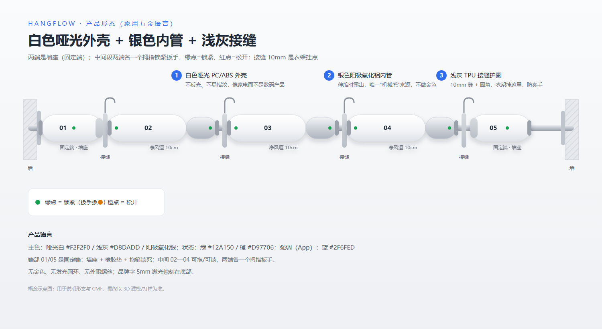

# 衣序 HangFlow · v2 完整方案书

> DDC2026 · 地瓜机器人黑客松 · 48H · 2026.12.05—12.07 · 上海张江
> 方案版本 v2.1 · 2026-11-23 · 所有性能为设计/仿真值，打样后替换实测

---

## 0. 一句话

**不换晾衣杆，让衣服自己让出风道。**

在现有晾衣杆上串 K+1 个抱箍式伸缩圆柱；衣架卡在相邻圆柱端头的 10mm 接缝里。圆柱伸长，把两边衣服推开；缩短，让它们靠拢。衣服仍挂在原杆上，调节器不承重。

---

## 1. 问题

梅雨季/回南天，衣服挤在杆上，间距只有 3—5cm，中间没有风，贴着的那面干不了，返潮、发臭。手推很烦：够不着、推不齐、湿衣服还重。

需要的其实不是"再买一台烘干机"，而是把现有晾衣杆的间距变成可调的。市面上的电动晾衣架要拆旧装新、单价 800—3000 元；租房用户不能打孔、不能换杆。

---

## 2. 产品形态

```
墙/边缘 ─[圆柱01]─ 衣架1 ─[圆柱02]─ 衣架2 ─[圆柱03]─ 衣架3 ─[圆柱04]─ 衣架4 ─[圆柱05]─ 墙/边缘
            接缝1            接缝2            接缝3            接缝4
```

- **K 件衣服 = K+1 个圆柱**：两端也有圆柱；4 件衣服 = 5 个圆柱。
- **接缝 10mm**：衣架钩挂在两个圆柱端头之间，可自由转动；杆承重，圆柱不承重。
- **抱箍式**：两半壳体扣在杆上，不拆杆、不打孔；搬家能带走。
- **一个圆柱 = 一段风道**：内部圆柱长度就是两件衣服之间的净风道。



---

## 3. 机械

### 3.1 单元组成

| 部件 | 作用 | 关键设计 |
|---|---|---|
| 抱箍两半 | 挂在杆上 | 铰链 + 卡扣；TPU/PTFE 内衬 |
| 锥面收口夹头 | 锁住杆/选择单向伸缩 | 开槽夹头环 + 外套筒；套筒内滑 6mm，12° 锥面径向压紧；保持力 82N（设计） |
| 外套管 | 固定段/电控仓 | Ø40—46mm，PETG/ASA |
| 内套管 | 伸出段 | 同轴，间隙 ≤0.15mm，防转筋 |
| 丝杆 + 螺母 | 旋转→直线 | T8 梯形丝杆，导程 8mm |
| 电机 | 驱动 | N20 6V 30rpm（建议 50rpm 版），额定 ≥0.1N·m |
| 长度传感 | 闭环 | AS5600 装丝杆轴，4096 计数/转 |
| 端头 U 托 | 10mm 接缝 | 圆角、防夹手 |

### 3.2 长度规格

| 类型 | 范围 | 说明 |
|---|---|---|
| 内部动力段 | **100—220mm** | 净风道 10—22cm |
| 内部被动短套 | 40/60/80mm | 4—10cm 窄风道，手动换段 |
| 端部段 | **30—120mm** | 外端锚定，内端自由伸缩；行程 90mm |
| 夹头保持力 | 82N | 需求 ≥40N，2.05× |
| 40N 位移 | 0.08mm | 夹头微滑 + 橡胶垫压缩，验收 <0.5mm |

### 3.3 端点锚定（v2 的关键修正）

端部 01/05 **只锁外端**，外端坐标 0/D 固定；内端 30—120mm 自由伸缩，吸收整条链的长度变化。若两端都锁死，等距/收衣没有行程，物理上不成立。

- 外端锚定：坐标不动，链不会整体漂移。
- 内端伸缩：等距/收衣时由它吸收总长变化。
- 端部锚定挂包：电机/丝杆/螺母塞在朝墙侧挂包（120mm），不占净距；安装要求锚定点离墙 ≥140mm。

### 3.4 未验证

- 夹头实际摩擦：喷漆/有尘杆可能从 82N 掉到 50N（仍够，但没实测）。
- TPU 夹头长期蠕变：0.08mm 是短期值，3 个月可能超 0.5mm。
- CAD 已用 OpenSCAD 渲染，但 90mm 缩进挂包的 CSG 过切/薄壁未逐件检查。

---

## 4. 电控

| 项 | 方案 |
|---|---|
| 主控 | ESP32-C3（每单元） |
| 驱动 | DRV8833 / TB6612 |
| 长度 | AS5600（I2C 0x36）+ 固件多圈计数 + NVS（magic+CRC16） |
| 夹持反馈 | 每端 1 个微动（P0 手动推套筒；P1 电动推套筒） |
| 限位 | 上下限位开关双保险 |
| 电源 | 1000mAh 18650 + TP4056 + MT3608；USB-C |
| 状态 | WS2812 单灯 + 按键 |
| 数量 | **P0 5 个单元全电动**（端部要吸收总长）；Lite 端部被动，约 −¥100 |

安全联锁：两端都松/都锁禁止电机动作；只允许"恰好一端锁"时伸缩；运动中夹持状态变化 50ms 内停；断网 500ms 停；卡死 300ms 判出；超程/低压/急停。

固件：`firmware-v2/esp32/`，PlatformIO 编译通过（RAM 12.1% / Flash 60.5%），未接真机。

---

## 5. 算法与控制

### 5.1 链模型

```
总链长 = ΣL_i + K×10mm
内部段净风道 g_i = L_i
中心距 = L_i + 10mm
外端锚点 0 / D 固定；ΣL + K×10 = D
```

### 5.2 夹持约束

- 锁死端点坐标绝对不动；拖动只改自由端。
- 拖动沿接缝传播，遇到锁死端点停；传不过去就拒绝。
- 自动模式：内部夹头临时松开，外端锚定；端部内端吸收总长变化；到位恢复锁态。

### 5.3 自动模式

| 模式 | 行为 |
|---|---|
| 等距 | 内部目标 10—22cm；端部吸收；12cm 示例 `[30,120,120,120,30]` |
| 加权 | 按湿度重新分配内部段，总长不变 |
| 收衣 | 内部回 100mm，端部回 60mm → `[60,100,100,100,60]` |

低于 10cm 的 8cm 需要被动短套，自动模式明确拒绝；15/20cm 因端部行程/锚定跨度不足拒绝。

### 5.4 视觉

- 每个圆柱顶部 ArUco `DICT_4X4_50`，ID 01—07，边长 30mm。
- 1.5m/30mm 标签约 18px；3 帧去抖后 5/5 识别，p95 0.30s。
- 视觉给 ID 和位置，长度闭环在单元本地；视觉失败降级到长度推算。

### 5.5 仿真结果（`sim-v2`，18/18 单测）

| 项 | 结果 |
|---|---|
| 规划耗时 | K=4 中位 44µs |
| 日常（12cm→收衣） | 4mm/s 37.0s（超 30s）；**7mm/s 24.1s（达标）** |
| 调节峰值 | 14N / 0.49A（不锁端 2.44A 且要重标定） |
| 长度闭环 | 上升 12.0s、稳态误差 +0.016mm、超调 0.02mm |
| 反向间隙 | ≤±72µm |
| 堵转 | 295ms |
| 误差预算 | RSS 0.53mm、最坏 0.87mm、100% 在 ±2mm 内 |
| 视觉 | 5 个 ID 全认全 100%、p95 0.30s |

---

## 6. 软件

```
手机网页 → HTTP/WS → RDK X5 中枢（视觉/链模型/规划）
                         │ MQTT
        ┌──────┬──────┬──────┬──────┬──────┐
        │单元01│单元02│单元03│单元04│单元05│
        └──────┴──────┴──────┴──────┴──────┘
```

- 中枢：Ubuntu 22.04、USB 相机、ArUco、FastAPI、MQTT；不直接驱动电机。
- 协议：`hangflow/unit/{id}/cmd` `{v,seq,op,target_mm,speed,clamp,timeout}`；`state` 10Hz；`evt`。
- 已实现：`software_v2/model.py`（端点锚定）、`protocol.py`、`mock_hub.py`、11 个单测。
- 待实现：FastAPI/WebSocket、真实 paho MQTT、ArUco 接入。

---

## 7. 演示

**3 分钟**：问题（3—5cm）→ 产品（衣服还挂原杆，圆柱=风道）→ 演示（收拢→等距 10cm→单段 12cm）→ 技术（唯一编码/长度闭环/端点锚定）→ 成本（打样 ¥890，量产 ¥601，售价 899 起）→ 收尾。

**现场操作**：扫码开网页 → 指 5 个圆柱/4 个接缝 → 收衣 → 一键等距 10cm → 拖单段到 12cm → 指识别/长度 → 急停 → 递手机。

**失败话术**：卡死保护、网页本地备份、视觉遮挡降级、衣架脱缝是待改边界；不编数据。

---

## 8. 成本与商业

| 口径 | 金额（不含 RDK） |
|---|---|
| 工程打样（5 单元 + 中枢配件 + 杆/墙） | **¥890.5** |
| 含 RDK 账面 | **¥1,439.5** |
| 1,000 台量产整机 | **¥601** |
| 纯物料精简打样 | ¥575 |

定价：Lite ¥399 / Pro Core ¥899 / Pro Vision ¥1,599；加购段 ¥149；端部件一对 ¥259。毛利按 1 万台物料口径约 47%，偏乐观；扣渠道售后约 36%。

市场：TAM 约 ¥1,300 亿量级、SAM 约 ¥150 亿、三年 SOM ¥3,000 万—¥1.8 亿（沿用 v1 估算口径，未做新调研）。B 端 2m 杆 10 件：11 个调节器，成本 ¥951，报价 ¥1,899/杆。

---

## 9. 风险与 Plan B

| 风险 | 概率/影响 | 处置 |
|---|---|---|
| 夹头摩擦不足/蠕变 | 中/高 | 三种杆面实测；POM 夹头 + 钢锥面备选；复紧维护 |
| 丝杆卡死/不自锁 | 中/中 | 300ms 堵转判据；动态刹车；常闭电磁刹车备选 |
| 端部挂包离墙 <140mm | 中/中 | 现场量杆；Lite 被动端件 |
| 5 个单元 Wi-Fi 拥堵 | 中/中 | RDK 热点 + 固定信道；串行指令 |
| 现场没实物 | 高/高 | app + 仿真 + 视频三套备份；答辩讲清"方案/设计值" |
| 时间不够 | 中/高 | P0 优先：3 件衣服/4 圆柱也能演示核心动作 |

---

## 10. 现在完成到什么程度

| 项 | 状态 |
|---|---|
| 概念/文档 | ✅ 11 份 v2 文档 |
| App | ✅ 可跑；拖拽/端点约束已修；CDP 验证 |
| 仿真 | ✅ 18/18；6 图 |
| 软件模型/协议/mock | ✅ 11/11 |
| 固件 | ✅ 编译通过；未接真机 |
| 机械 | 🟡 设计 + OpenSCAD 渲染；未打样 |
| 电控 | 🟡 BOM/接线；未打样 |
| Deck | ✅ 10 页 PDF |
| 实物 | ❌ 未打样（赛前任务） |

---

## 11. 文件索引

- 概念：[00-总览与架构](00-总览与架构.md)
- 机械：[01-机械结构](01-机械结构.md) · [cad-v2](../../hardware/cad-v2/README.md)
- 电控：[02-电控与BOM](02-电控与BOM.md) · [wiring-v2](../../hardware/wiring-v2/README.md)
- 算法：[03-算法与控制](03-算法与控制.md) · [sim-v2](../../sim-v2)
- 软件：[04-软件与协议](04-软件与协议.md) · [software_v2](../../software_v2/README.md)
- 商业：[05-成本与商业](05-成本与商业.md)
- 演示：[06-演示与答辩](06-演示与答辩.md)
- 工业设计：[07-工业设计方向](07-工业设计方向.md)
- 约束：[09](09-夹持约束与拖动规则.md) · [10](10-端点锚定模型.md)
- 路线：[11-差距分析与路线](11-差距分析与路线.md)
- 交互：[app-v2](../../app-v2/index.html)
- 固件：[firmware-v2](../../firmware-v2/esp32/README.md)
- Deck：[deck-v2](../../deck-v2/衣序-HangFlow-DDC2026.pdf)

