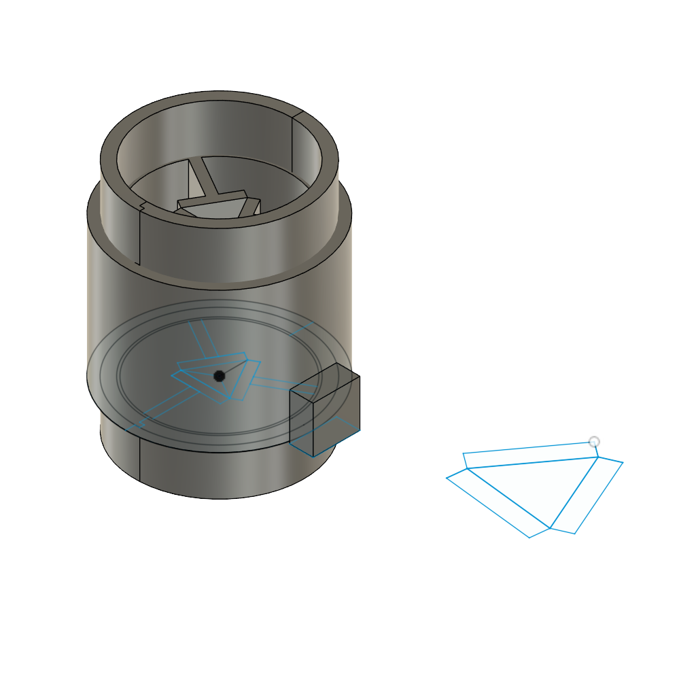

# 同事的「排骨三角活塞版 2.0」怎么接

> 文件：[piston-v2.f3d](../../hardware/cad-v2/colleague/piston-v2.f3d)（原名 `晾衣杆机器人_排骨三角活塞版2.0.f3d`，Fusion 360，333KB）
> 说明：只拿到了 `.f3d` 几何，没有参数表/装配说明；下面是**从预览和结构形态做的判断**，尺寸和受力要同事确认。

---

## 1. 它看起来是什么

预览是一个圆柱壳体 + 内部**三角凸轮/三角活塞** + 三片沿径向布置的**排骨状推块**，侧面有一个拨杆/旋钮，另有一个蓝色三角件（像是转动三角活塞的钥匙/工具）。

推测工作方式：**转动三角活塞 → 三个排骨块同步径向伸出/收回**，从内侧撑住杆或从外侧夹住杆；三角凸轮保证三块同步、自定心。

它和我们的方案是两条路线：

| | 我们的锥面收口夹头 | 同事的三角活塞 |
|---|---|---|
| 夹紧方向 | 轴向推套筒 → 锥面转成径向 | 周向转三角 → 径向推三块 |
| 行程 | 轴向 5—8mm | 径向，取决于三角升程 |
| 自定心 | 靠 6 片夹头环 | 三角三块天然 120° 自定心 |
| 零件数 | 夹头环 + 套筒 + 弹簧 + 微动 | 壳体 + 三角活塞 + 3 排骨 + 拨杆/销，更多 |
| 优点 | 简单、轴向短、易手动 | 径向力大、三块同步、可能自锁 |
| 风险 | 锥面摩擦/蠕变 | 零件多、三角面磨损、拨杆回差、装配复杂 |

---

## 2. 和我们 v2 的关系

- 我们解决的是**定长间距**：圆柱长度 = 风道；夹头只是"锁住端点/选单向伸缩"。
- 同事的"晾衣杆机器人"更像在解决**夹紧/爬杆/径向锁**。如果他的三角活塞是夹杆，可以借来当**端部锚定夹头**；如果是杆内爬行机构，和我们的链不是同一层。
- 不能直接把 `.f3d` 塞进我们的 BOM：没有尺寸、材料、行程、夹紧力，也没有和 Ø25 杆的配合。

---

## 3. 三种接法

### A. 直接替换我们的锥面夹头（不建议现在做）

- 需要：外径 ≤Ø66、径向行程 ≤8mm、保持力 ≥82N、手动拨杆可操作、成本 ≤¥15。
- 影响：所有单元的端头、外套管、BOM、装配说明全改；赛前 12 天风险太高。

### B. 只用在端部锚定（可选）

- 端部 01/05 需要更大的锚定力/更短轴向；三角活塞如果径向力更大，可以用在端部，内部仍用锥面夹头。
- 需要同事给：外径、径向行程、保持力、拨杆扭矩、零件数。

### C. 作为 B 方案/对比素材（推荐现在）

- P0 继续用锥面夹头；把三角活塞放进"备选夹头"章节和答辩对比：
  *"我们评估过三角活塞，径向力更大但零件多/回差大；P0 选锥面，是因为赛前要可制造、可手动。"*
- 等打样后做 A/B：同一根 Ø25 杆，测 40N 下拉位移、100 次锁松、拨杆力。

---

## 4. 需要同事补的数据

1. 适配杆径、外径、总长、径向行程（mm）。
2. 三角升程/拨杆角度；锁紧后是否自锁。
3. 三块排骨的材料/摩擦面；设计保持力（N）。
4. 零件数、打印/加工方式、单件成本。
5. 装配关系：三角活塞怎么转、拨杆怎么限位、微动装哪。
6. 最好给 STEP/STL，或者 Fusion 里导出的二维图。

---

## 5. 结论

**现在不换 P0。** 同事的方案值得作为端部锚定或下一代夹头的备选；先把他的尺寸/力/成本要过来，用同一根杆做 A/B。我们当前的锥面夹头已经能支撑 5 单元演示，赛前不应该再改夹头结构。
