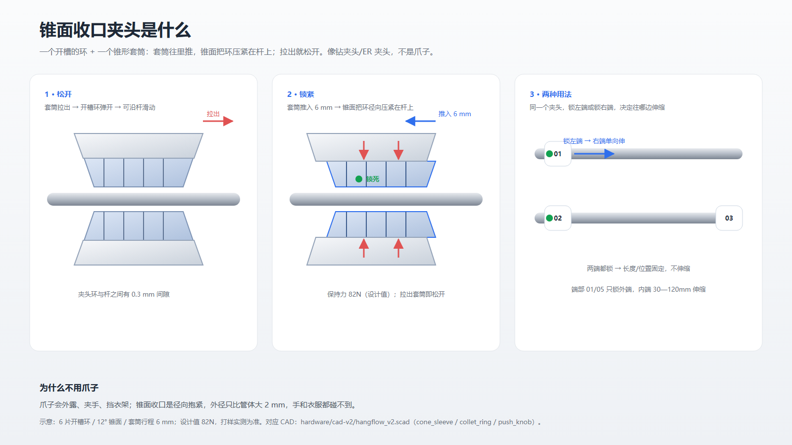

# 锥面收口夹头是什么（给非机械同学看的）

> 一句话：**一个开槽的环，外面套一个锥形套筒；套筒往里推，锥面把环径向压紧在杆上；拉出就松开。** 不是爪子，没有外露夹爪。

---

## 1. 它长什么样

- **开槽夹头环**：一圈弹性材料（TPU 95A / POM），开 5 条半槽 + 1 条全开缝，可以掰开扣在杆上；内孔比杆大 0.3mm，松态能滑动。
- **锥面套筒**：外套筒内壁是 12° 锥面；套筒往内推 6mm，锥面把 6 片夹头环往中心压，抱住杆。
- **推钮/拨杆**：手推或拨 90°，行程 6mm；反向拉出即松开。
- **微动开关**：检测套筒在"锁位"还是"松位"，只报状态，不测夹紧力。

## 2. 怎么用

| 操作 | 结果 |
|---|---|
| 套筒拉出 | 夹头环弹开，单元可沿杆滑动/取下 |
| 套筒推入 6mm | 径向抱紧杆，摩擦锁死 |
| 只锁一端 | 另一端可伸缩 → 单向伸缩 |
| 两端都锁 | 长度/位置固定，不伸缩 |
| 端部 01/05 | 只锁外端，内端 30—120mm 伸缩 |

设计值：12° 锥面、40N 轴向推力 → 117N 径向夹紧 → **82N 保持力**（需求 ≥40N，2.05×）。打样后以实测为准。

## 3. 为什么不是爪子

- 爪子会外露、夹手、挡衣架；锥面收口是**径向抱紧**，外径只比管体大 2mm，手和衣服碰不到。
- 三块/六块同步收口，自定心；不会像单爪那样把杆推偏。
- 松态有 0.3mm 间隙，整条链能滑；锁态靠摩擦，不靠齿咬杆，不伤杆面。

## 4. 外部参考（这是什么标准件思路）

- 夹头/筒夹（collet）原理：<https://en.wikipedia.org/wiki/Collet>
- 钻夹头（drill chuck）：<https://en.wikipedia.org/wiki/Drill_chuck>
- ER 夹头就是同一种"锥面收口"思路，只是工业上用于铣刀/刀具；我们把它缩小、改成手动推套筒。

> 看 ER 夹头/钻夹头怎么锁刀柄，就理解我们这个怎么锁晾衣杆。

## 5. 我们的文件

- CAD 源码：`hardware/cad-v2/hangflow_v2.scad`，零件名 `cone_sleeve` / `collet_ring` / `push_knob`。
- 机械说明：`docs/v2/01-机械结构.md` §2。
- 技术剖面：`assets/diagrams/mech-v2-clamp.svg`（这张是给机械同学看的，字小；上面那张是给所有人看的）。
- 同事的三角活塞方案对比：`docs/v2/14-同事三角活塞方案对比.md`。
